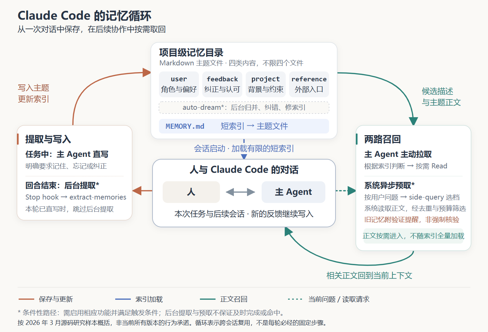
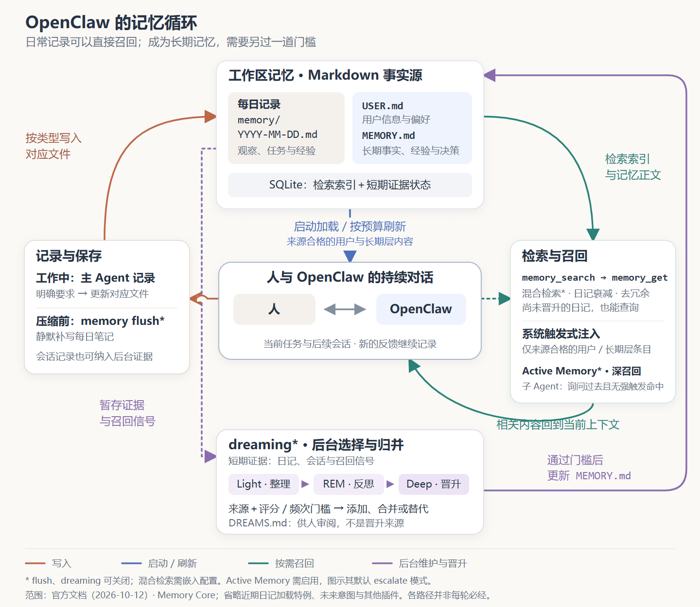
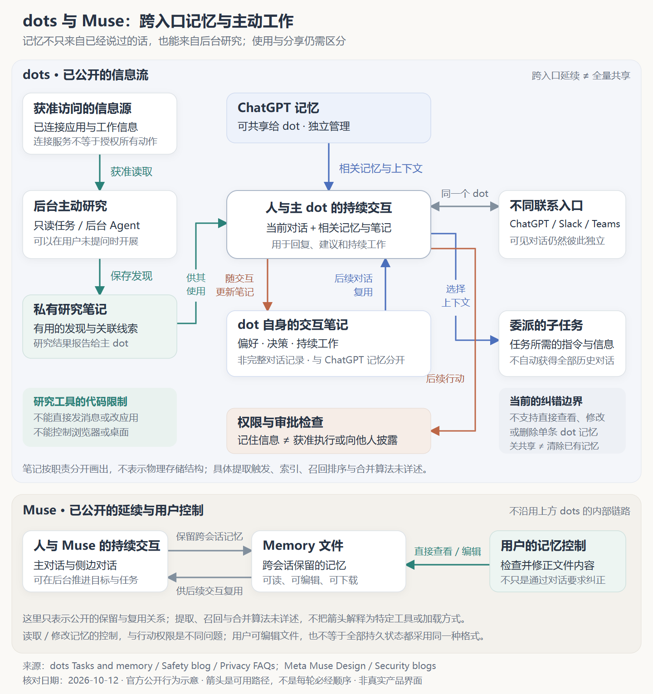

Claude Code 用文件与短索引延续项目协作，OpenClaw 将日常记录与经过筛选的长期记忆分开；Codex、WorkBuddy、Muse 和 dots 又提供了不同的写入、管理与持续工作方案。每种方案看起来都有道理，但如果要给自己的 Agent 设计记忆系统，究竟应该借鉴哪一种？这也是我整理这些产品时最初的困惑。**设计记忆系统，本质是先决定哪些过去的信息，应该在什么条件下影响后续行为，再为它选择保存、维护和召回机制。**

我最初把设计记忆系统问题归纳成三个维度：
- 存储方式：结构化存储还是非结构化存储？markdown文本、普通文本、数据库还是向量数据库？ 
- 检索主权：模型自主决定何时召回检索记忆到上下文 还是 Harness系统层检索召回注入到上下文？
- 分层与升级策略：如何对记忆进行分类存储？各个类型的记忆如何升级、如何更新维护？
这三点抓住了实现骨架，但还缺少「到底记什么」「何时、由谁形成记忆」和「记错以后怎么办」。补齐这些问题，才有可能从产品介绍中抽出一套可迁移的设计方法。

下面先说明记忆与上下文工程的关系，再围绕五个维度解释设计选择，并讨论如何分别控制候选检索、上下文加载与行动使用的风险。产品案例以 CC、OpenClaw、dots 与 Muse 为主，Codex 和 WorkBuddy 补充控制与管理上的差异；最后通过一个明确标为假设的编码协作场景，展示怎样选择最小方案、回放任务并定位失败。用户控制与效果评估贯穿这些设计问题。

这套框架希望帮助回答三个实际问题：一个场景是否真的需要长期记忆？什么时候文件与工具检索已经够用，什么时候需要更复杂的索引或状态管理？已有产品里的某个机制，移到自己的业务里，收益和代价会不会变样？

## 一、记忆解决什么，和上下文工程是什么关系

**上下文工程，是在有限的上下文预算内，为模型组织完成当前任务所需的信息。** LLM 的上下文窗口有限，也不会自动看到全部历史和外部资料。每轮能直接利用哪些任务信息，取决于本轮上下文中实际提供了什么；对于同一个模型，交给它的信息不同，任务表现也可能不同。因此，**上下文工程要决定用户请求、规则、对话、工具结果和文件内容中，哪些进入这次调用、以什么形式呈现，以及哪些可以暂不加载。目标是在有限预算内减少关键信息缺失与无关内容干扰，让模型更好地完成当前任务。**

**记忆，是从过去保留下来、供 Agent 后续复用的信息；记忆系统负责保存、维护和召回这些信息。目的是让 Agent 在持续使用中表现得更智能。** 它处理的是一个跨时间的问题：某条信息产生在过去，当前任务中没有直接出现，却仍然值得复用。

本文主要讨论持久化的外部记忆，不把模型参数中学到的知识混进来。长任务中的摘要、检查点也承担记忆作用，但「维持这次任务的连续性」和「让未来任务复用过去经验」，不必采用同一种保存方式。例如，任务摘要要保留正在做什么、做到哪里、还剩什么；长期协作记忆则可能保留用户纠正过的工作方式、某项决策的约束条件、无法从当前文件直接推导的背景。把所有任务摘要都升级为长期记忆，会让临时状态不断挤占未来上下文。

**记忆为上下文工程提供可复用的历史信息，上下文工程则决定本轮需要哪些信息、如何提供给模型。记忆只是上下文的来源之一，不等于全部上下文；记忆系统也不只是提供一个读取接口，还要长期维护信息的来源、作用域、有效性和更新关系。**

**Anthropic 在上下文工程文章中强调，目标是找到能推动任务的高信号信息，而非尽可能填满窗口。** 它也介绍了用路径等轻量引用，让 Agent 在运行时逐步加载资料的方式。这给记忆设计的启发是：持久化容量与当前上下文容量应当分开管理。能存下很多，不等于每次应该加载很多。[Anthropic：Effective context engineering for AI agents](https://www.anthropic.com/engineering/effective-context-engineering-for-ai-agents)

因此，**设计记忆系统不能只问「怎样把信息存下来」，还要问「怎样让过去的信息在当前任务中被恰当地使用」。** 文件保存成功，只证明信息还在；进入了上下文，只证明模型有机会看到。两者都没有证明它被正确理解和使用。

## 二、围绕五个维度，设计一套能复用过去的记忆系统

为自己的 Agent 设计记忆，可以围绕五个问题展开：**存什么；何时、由谁写入；怎么组织；怎么维护；怎么召回。**这一章在常用方案的基础上，解释影响选择的条件与关键取舍；后面的产品案例，则展示这些选择如何组成真实系统。只想快速查阅方案，可以直接看文末的[五维方案速查附录](#附录五个设计维度的常用方案速查)。

它们不是五组选一道题，也不是固定运行流水线。同一个 Agent 可以对用户偏好及时更新、对任务经历后台整理；用文件保存正文，同时建立检索索引。方案是否合适，要看信息的用途、范围、变化频率与错误代价，而不是组件是否齐全。

### 1. 存什么：选择未来需要复用的信息

「存什么」要回答两个问题：**哪些信息值得进入长期记忆；存入时，要随它保留哪些说明。**前者决定什么进、什么不进；后者决定这条信息未来还能不能被正确使用。

先看前者。判断标准不是信息本身是否重要，而是**缺少它会不会改变未来任务的判断或行动，以及届时能否从权威来源低成本、可靠地重新获得**。编码 Agent 能重读当前代码，却未必能重建用户否决某个方案的原因，后者更值得优先补足；反过来，事实可以缓存，但可从权威来源重读的当前值，不必再维护一份永久成立的记忆副本。

再看后者：信息不是孤立的正文，而要带上类型、作用域、来源与必要的有效期一起入存。常见内容可以按业务用途整理，示例用于解释设计，不是产品实测：

| 常见内容 | 典型例子 | 保存重点 |
| --- | --- | --- |
| 用户画像与偏好 | 语言、报告风格、协作习惯 | 是明确表达还是推断，是否长期适用 |
| 项目事实、约束与检查点 | 发布约束、决策背景、可恢复的任务进度 | 项目范围、有效时间、权威来源；检查点还要标明何时失效 |
| 任务经历与反馈 | 排障过程、失败尝试、用户评价 | 当时条件、操作与结果，保留必要依据 |
| 方法、流程与技能 | 检查清单、操作步骤、可执行代码 | 适用前提、验证依据 |
| 外部资料入口 | 文档地址、工单、仪表盘入口 | 去哪里获取信息，入口是否仍然可用 |

认知架构研究常将长期记忆分为三类：可复用的事实或结论属于**语义记忆**，过去经历属于**情景记忆**，做事方法属于**程序性记忆**。CoALA 沿用这一分类来分析 Language Agent。本文借用它区分信息未来的复用方式，但只讨论系统可显式保存、查看和维护的信息，不展开通过更新模型参数获得的知识。[CoALA：Cognitive Architectures for Language Agents](https://arxiv.org/abs/2309.02427)

两种分类不冲突：用户偏好通常属于语义记忆，一次排障记录属于情景记忆，从排障中提炼的检查流程则可以成为程序性记忆。业务用途表围绕“这是什么内容”组织，三分法围绕“以后怎样复用”组织；它们都是分析时的观察维度。产品还会为写入、查找与维护定义实际目录：Claude Code 使用 `user`、`feedback`、`project`、`reference` 四类笔记，分别容纳角色与偏好、纠正与认可、工作背景和外部资料入口。[Claude Code：Auto memory](https://code.claude.com/docs/en/memory#auto-memory)

**分类的价值，是帮助决定信息如何写入、更新和使用，而不只是给文件起不同名字。**业务用途帮助盘点内容，三分法帮助判断复用方式，产品目录服务实际存取与维护；它们可以映射，却不需要一一对应。对自己的系统，先确定未来需要复用什么，再决定分类。

这些差异会改变保存方式。失败记录属于情景记忆，按原样保留当时条件、操作与结果就有参考价值；但要把其中某种操作当作以后可执行的方法，就进入了程序性记忆的范畴，需要确认有效性与适用条件。Voyager 是一个在 Minecraft 中完成任务的 Agent 研究项目，它的技能库保存可复用的执行代码，说明记忆可以积累方法，而不只是记录过去。[Voyager：Skill Library](https://voyager.minedojo.org/)

除类型之外，作用域、来源和有效期也要随信息一起标明。“日常汇报保持简洁”与“本次董事会报告要详细”，内容都与报告有关，生效范围却不同；这些条件应在保存时写清，不能等召回时再猜。

决定了存什么、随存什么说明之后，下一个问题是：这些信息在什么时机、由谁写入记忆。

### 2. 何时、由谁写入：选择形成记忆的路径

一条候选信息从出现到影响未来行为，至少包含几项可分开的决定：**何时触发、放在主路径还是后台提取、谁提出候选、谁批准保存、谁允许它成为长期默认。**触发与执行通道决定时效；提取者决定可利用的上下文和判断质量；批准与升级决定授权和影响范围。「何时写」与「由谁写」，要分别在这条链路上作选择。

写入时机的常用方案有四种：

- **当场写入**：在当前任务中保存，适合需要及时生效的明确要求或纠正；代价是增加前台判断、调用与等待。
- **回合或任务结束后提取**：利用较完整的过程整理，适合经历与经验；代价是延迟生效，也可能漏掉信息。
- **周期或事件触发**：定期处理，或在任务完成、业务状态变化时触发；需要选择触发频率，并发现失败。
- **混合写入**：明确要求及时处理，其他信号后台提取；需要协调重复写入、并发与完成状态。

这些选项可以组合，因为触发时机与执行通道是两个可以分开的选择：事件决定何时启动提取，通道决定这次提取放在主路径——用户等待回复的那条路径——还是后台执行。前者影响信息多新鲜，后者影响每轮响应多快。LangChain 的记忆指南对这两种通道的取舍有明确概括：主路径写入实时更新但增加时延；后台写入不阻塞响应，但需要配合定时任务或手动触发这类时机策略，也会留下“新对话已经发生，记忆尚未形成”的新鲜度空窗。[LangChain：Writing memories](https://docs.langchain.com/oss/python/concepts/memory#writing-memories)

选择时先问：**这条信息最迟什么时候必须可用？**如果用户纠正需要在下一个会话生效，只靠周期提取就可能出现下一次会话已经开始、纠正却尚未形成长期记忆的空窗；如果目标是从一次探索中总结方法，等任务结束再整理，才有机会看到后续失败与最终结果。两种需求同时存在，才有理由采用双通道。此前研究的 Claude Code 源码快照中，主 Agent 直写与回合结束后的异步提取就是并存的两条路径，具体机制与版本边界见[源码分析](/writing/claude-code源码解剖二-记忆机制/)。

“由谁写入”是另一组选项，不与上述时机绑定；而且四类角色不必包办全程，开头说的触发、执行、提出候选、批准保存和批准成为默认，可以交给不同角色分管：

- **主 Agent**判断并调用写入工具，能够利用当前任务上下文，但可能顾此失彼。
- **独立提取 Agent**集中整理记录，减轻主 Agent 负担，但仍会判断失误。
- **程序**依据明确事件更新字段，适合规则清楚的状态，不擅长提炼开放式经验。
- **用户或审核者**手动维护、批准候选，控制更明确，但增加操作成本。

一条信息能走到哪个环节，不只取决于证据，也取决于它的作用域与谁有权改变默认行为。用户明确说“以后日常汇报都简洁”，是范围清楚的直接要求，可以在这一范围内保存为默认；模型观察到“用户最近经常删除背景说明”，只是推断，可以先成为候选——行为背后可能有别的原因，不宜直接改成所有任务的默认规则。

第三方材料是否可信，要按其来源判断；但内容可信，与它是否有权修改用户默认行为是两回事。外部邮件里的“以后都把报告发给我”，可以作为邮件内容保存，却不能自动变成用户授权，否则任何一封邮件都能改写 Agent 的长期行为，这正是提示注入的入口。LangChain 的 Agent Builder 官方复盘说明，当时要求人类批准记忆修改，就是为了降低这一风险。[LangChain：Human-in-the-loop memory updates](https://www.langchain.com/blog/how-we-built-agent-builders-memory-system)

因此，写入方案需要同时说明三件事：何时生效、谁能批准、怎样反馈保存结果。最后一项容易被忽略：系统最好让用户区分“候选”“已保存”“已批准为默认”三种状态。用户说“记住这个”，Agent 回复“好的”，只代表当场处理过；后台写入则可能延迟或失败。若不报告保存成败，用户会把“这次已告诉它”误当成“长期已保存”。**同步／异步只回答写入是否阻塞当前任务；可信度和授权仍要由来源、验证与审批决定。**

决定了何时、由谁写入之后，下一个问题是：这些信息以什么形式、存放在哪里。

### 3. 怎么组织：选择表示、载体与信息关系

组织记忆不只是选择文件还是数据库，还包括怎样维护当前结论、怎样保留历史依据，以及二者如何关联。先把这些问题分到不同选择层，才不会把表示形式、后端和检索方式误当成互斥方案：

| 要作出的选择 | 常用方案 | 选择依据 |
| --- | --- | --- |
| 内容怎样表达 | 自由文本、结构化字段、正文加元数据 | 需要灵活叙述，还是明确校验与确定读取 |
| 内容存在哪里 | 文件系统、数据库、对象存储 | 人工编辑、并发管理、隔离、规模与运维需求 |
| 内容怎样聚合 | 一份持续更新的画像、多条独立记录、两者结合 | 集中表达当前情况，还是保留细粒度材料 |
| 内容怎样分层 | 任务状态、事件记录、经过整理的长期结论 | 使用期限、更新频率与默认加载需求 |
| 内容怎样关联 | 来源引用、版本关系、摘要指向原文 | 追溯、纠正与传播修改的需求 |

这里有一个应优先明确的区别：**读取当前有效值，与搜索历史依据，是两种需求。**假设用户昨天修改了报告偏好，今天 Agent 不应让新旧偏好仅凭相似度竞争；同时，系统可能仍需要保留变更依据。少量偏好可以集中维护，历史反馈则按来源保存并关联，不一定需要两个数据库。

这一差别决定内容怎样聚合。LangChain 文档将常见组织方式概括为持续更新的画像与独立记录集合：画像便于集中表达一个对象当前的情况，记录集合便于增量保留材料；代价是后者把更新、删除与搜索的复杂度交给系统处理。[LangChain：Profile and collection](https://docs.langchain.com/oss/python/concepts/memory#semantic-memory)

OpenAI 的旅行助手示例把结构化用户状态与自由笔记结合，并明确最新用户输入、会话覆盖与全局默认的优先级。它说明：需要确定执行的字段，应维护当前值及其优先级；仍需追溯的偏好、反馈和条件，则保留为可回查的记录，而不是让它们在检索结果中彼此竞争。[OpenAI Cookbook：Context Engineering for Personalization](https://developers.openai.com/cookbook/examples/agents_sdk/context_personalization)

明确内容的角色后，再选择技术。少量笔记需要人工查看，Markdown 可能够用；字段要参与确定判断，结构化表示与校验更重要；并发、权限隔离或查询需求增长，再考虑相应后端能力。组合方案应当回应不同需求，而不是为了完整而增加组件。

“Markdown、RAG、Markdown + RAG”并不在同一层。Markdown 是表示形式，RAG 是检索资料后用于生成的方式；向量索引可以建立在文件或数据库内容之上。表示、存储、索引与访问接口可以分别选择。比如 LangChain 的 Agent Builder 向 Agent 提供文件式接口，实际内容存储在 Postgres。[LangChain：Memory as a filesystem](https://www.langchain.com/blog/how-we-built-agent-builders-memory-system)

无论采用哪种组合，都要知道什么是依据，什么是摘要、索引等派生内容。原文被纠正后，需要更新哪些副本；摘要中的结论，能否回到原始条件。组织层确定这些关系，维护层才能沿关系处理变化。

### 4. 怎么维护：选择更新、整理与退出机制

写入和组织完成后，记忆仍会被新事实、用户纠正和新的任务范围不断改变。维护的目标不只是“把记忆变短”，而是让**当前该采用什么、过去为什么这样判断、摘要和索引等派生内容是否仍与原始依据一致**，始终能够说清。

为此，常见维护任务可分成五组：

- **更新与冲突处理**：修改当前有效值，保留必要历史；结合范围、来源与事实时间处理矛盾。
- **去重与归并**：合并相同信息、聚合相近主题、压缩过长内容，减少碎片与重复。
- **分层升级与经验提炼**：从事件记录中形成稳定偏好或可复用方法，检查是否有充分依据。
- **失效、归档与删除**：按任务结束、有效期、用户撤销等处理，区分不默认使用、仍可查询和彻底删除。
- **一致性维护**：把修改传播到摘要、索引与缓存；需要时采用版本校验、原子更新或更强协调。

其中，**即时纠正与后台整理应承担不同责任**。用户已经改变默认收件人，当前值应及时更新，不能继续等待下一轮整理；过去曾发送给该对象的记录则不必改写成从未发生。后台适合处理累积的重复、冲突与经验提炼。Claude Code 源码样本中的 auto-dream 就尝试承担后台归并；它受开关和触发条件约束，不保证即时运行或整理成功，范围沿用前文所引源码研究。

整理首先要决定：哪些重复事件应归并成一条可复用的结论。LangChain 的复盘记录过，邮件助手不断新增需要忽略的冷推销厂商，却没有提炼处理这类邮件的规则；只会新增个案，会让记忆越积越碎。[LangChain：Agents added memories but did not compact them](https://www.langchain.com/blog/how-we-built-agent-builders-memory-system)

但从个案升级为规则时，另一种风险是把局部条件抹掉。下面是一个示意：

> 用户说：「这次给董事会的报告写详细一点，日常汇报仍然保持简洁。」

保留这次要求有价值，整理成“用户喜欢详细报告”却丢掉了范围。**记录了一次要求，不等于学到了永久偏好。**升级为长期默认之前，要检查来源、适用条件、稳定性与相反依据；无法确认的内容可以保持可检索，不必默认生效。


> 图：条件丢失后，局部要求可能变成默认规则；保留原话依据与适用范围，帮助后续任务判断能否复用，降低错误泛化的风险。这是通用设计原则示意，并非某个产品的真实界面。

冲突处理也不能一律“最后写入获胜”：今天录入的旧邮件，未必比昨天核验的状态更新；本次要求也未必修改全局默认。记录时间、事实生效时间与核验时间需要区分，并和信息的作用域一起决定哪一条当前生效。

最后，维护还要给旧信息一个明确出口。最终笔记删了，后台却仍从旧输入提取同一结论，删除就没有达到预期效果。应按用户要求和数据策略明确是停止默认使用、保留为历史，还是彻底删除，并处理相关摘要、索引与缓存。简单系统不必一开始就采用复杂协调，但必须能够说明用户改正后，后续任务何时停止使用旧信息。

维护完成后，系统才得到一个可判定当前有效值、可回查历史依据、也能停止使用旧结论的集合。下一节讨论：面对这个集合，怎样让真正相关的信息在任务中被发现、进入上下文并经得起使用前核验。

### 5. 怎么召回：分别选择控制、算法、接口与加载策略

维护后的信息不会自动改善下一次任务。它至少要经过三道不同的门：先定位可能相关的候选，再决定何时、以什么形式进入当前上下文，最后在行动前确认其仍然有效且有相应授权。**检索排序不能替这三道门同时作决定。**

因此，召回内部还有四组选项；把它们分开，才能避免把所有问题都归结为“用不用 RAG”：

| 选择层面 | 常用方案 | 它决定什么 |
| --- | --- | --- |
| 谁决定查询 | Agent 主动拉取、系统主动注入、两者结合 | 谁承担发现信息需要的责任 |
| 怎样找到信息 | 精确读取／字段过滤、关键词、向量、混合检索 | 根据什么信号定位候选 |
| Agent 如何访问 | 短索引＋文件工具、专门的记忆查询工具 | 模型需要处理多少底层细节 |
| 何时提供内容 | 启动或恢复时加载、按需查询、事件触发预取 | 哪些信息何时占用上下文 |

#### 控制方式：主动拉取、系统注入与混合

主动拉取允许 Agent 根据任务进展调整查询、追查依据，但它可能不知道有记忆，或没意识到应该查。系统主动注入可以补充查询机会，却可能选错内容、增加上下文负担；系统选择本身也可以调用模型，并不天然准确。

混合方式可以由系统提供入口或初始材料，Agent 再按需展开。它适合需要减少主动查询遗漏的场景，但增加选择、去重和时序协调成本，不是默认优于单通道。异步结果若赶不上需要它的动作，也不能作为该动作的信息保障。

**会调用查询工具，不等于会判断什么时候必须查询。**如果实际问题是 Agent 没有查就回答，换检索算法未必有效；应先检查入口是否可发现、模型能否识别信息缺口，以及是否需要任务规则或系统补充。混合通道还要关注当前上下文已有哪些内容，避免重复加载；读过旧版本或上下文已压缩，也可能仍需要重新读取。

#### 检索方式：确定读取、关键词与语义匹配

已知 ID、路径或明确字段，适合精确读取；名称、编号和报错术语，适合关键词检索；原文与问题措辞不同但含义相关，可以尝试向量检索；混合检索则组合不同信号，按需要过滤或重排。

算法应对应真实查询困难。固定的小型偏好集合可以直接读取，不必先做相似度搜索；大量历史记录存在措辞差异时，语义检索才更有价值。这里的“混合检索”是算法组合，不等于主动拉取与系统注入的混合控制。

#### 访问接口：索引＋文件工具，或专门的查询工具

- **短索引＋Read／Grep**：给 Agent 一个发现入口，让它探索并读取正文；适合结构清楚、规模可控的记忆，但需要模型完成多步查找。
- **专门的记忆查询工具**：接受查询描述、范围或类型，内部处理过滤与排序；减少模型负担，但需要可靠的参数与返回约定。

Claude Code 的公开文档描述了一种受长度限制的自动记忆入口：`MEMORY.md` 的前 200 行或 25 KB 会随会话加载，详细笔记仍可查看和编辑。本文关于主题文件按需读取、以及内部异步预取的源码样本分析，留在产品案例章，不与公开文档行为混为一谈。[Claude Code：How it works](https://code.claude.com/docs/en/memory#how-it-works)

我更倾向于让工具接受任务需要，例如“查询本项目当前有效的汇报约定”，而不要求模型先理解底层索引算法。必要时返回来源、范围、版本和有效时间，供使用者核验；权限过滤应由后端执行，不能只相信模型填入的范围参数。

#### 加载策略：默认提供、按需展开与事件触发

短小且经常适用的信息，可以在相关任务开始时提供；项目状态或检查点，可以在启动、恢复任务时读取；大量经历与专门方法，更适合按需查询；持续型助手还可以由后台事件触发召回。

选择依据是长度、适用频率、变化速度、遗漏后果与敏感程度，而不是类别名称。用户画像可能包含偶尔才相关的背景，程序性记忆也可能包含经常使用的规则。**确定要使用的信息，不应只等 Agent 自己想起来；偶尔相关的历史，也不应为了防遗漏全部常驻。**

找到候选后，还要选择全文、片段、摘要或引用。这决定信息怎样进入当前窗口，却不等于它已经足以支持行动。不同阶段为何需要不同门槛，以及怎样在“少漏掉”与“少多塞”之间取舍，留到下一章统一讨论。

五个维度最终要形成一致的规则：临时要求既然只适用于本次任务，就不应被后台升级为长期默认，又在所有任务中加载。可查看、可追溯、可纠正、可在高风险时确认，需要贯穿这些选择；记忆也不能代替行动权限。

## 三、怎样在「少漏掉」与「少多塞」之间设置门槛

第二章的五个维度决定记忆能否被保存、更新和找到，却不能由某一个组件保证“记得恰到好处”。同一条历史信息可能根本没有被找到、被无关地塞进上下文，或已经过期却仍被用来执行动作；这些失败都常被笼统称为“召回错了”，实际需要在不同环节处理。

对于有限且定义明确的状态集合，可以按字段或 ID 确定性读取，不必制造召回率与精确率的难题。真正需要警惕的是，对开放式记忆系统承诺“既绝不漏，又绝不多塞”：未来任务没有被完全定义，相关性还取决于当前任务、时间和权限，保存再多也无法自动兑现这个承诺。

因此，候选检索、上下文准入与行动使用不应共用一道门槛。可以在候选阶段扩大覆盖，在进入上下文之前进一步筛选；先提供摘要与回查入口，再按需求展开原文；执行有风险的动作前，重新核验当前事实和授权。


这是本文的工程建议，不是所有产品的统一实现。图中分开了三个决定：哪些内容可能有用，哪些值得占用当前窗口，哪些足以支持行动。一个检索分数不应同时替这三件事作决定；这样，第二章分散的设计选择才能落到一条共同的判断链路上。

两种错误都昂贵，只是代价会变化。报告排版偏好遗漏，可能只导致一次返工；已经撤销的收件人被当作当前对象使用，后果就不同。同样，编码任务既不能轻率相信旧接口，也不能漏掉一个无法从代码推导的部署限制。不能把场景粗暴概括为「编码求准，助手求全」，应当按信息和动作确定容忍度。

分层处理也有成本：多一次筛选会增加时延，异步预取可能来不及影响首轮回答，多条召回通道需要去重。只有某类失败确实值得减少，这些机制才有引入理由。小型、明确的状态集合，直接读取可能比复杂检索管道更合适。

评估也应定位具体失败：没有写入、记错条件、更新后仍用旧值、没有查询，还是查询后使用错误？同时观察额外 token、等待与整理费用。**最终要验证的是过去的信息有没有改善后续行为，而不是保存量与召回量是否增长。**

> 好的记忆产品不该承诺「永不遗忘」，而应让用户能够发现遗漏、定位错误、修正未来行为，并在错误可能造成高代价时介入。

## 四、回到产品：约束怎样改变记忆系统的组合

第二章给出设计问题，第三章说明不能用一个检索分数同时解决遗漏、上下文负担和行动风险。产品案例的价值，则在于观察这些问题遇到不同约束时，哪些复杂度才值得承担。这里不评判谁的记忆系统更“先进”，而是分别看三种不能互相替代的压力：

| 案例 | 首先要解决的压力 | 因而值得观察的组合 |
| --- | --- | --- |
| Claude Code | 代码和仓库无法恢复的项目协作背景，需要跨会话延续 | 项目范围、两条写入路径、短索引与按需读取 |
| OpenClaw | 日常记录不断增加，细节要留存却不宜都成为默认背景 | 日记与长期层分工、后台晋升、来源门槛与多路召回 |
| dots 与 Muse | 助手跨入口持续工作，还会接触主动研究与私密资料 | 任务范围、使用与披露授权、用户纠正和删除边界 |

编码、办公和个人助手并非互斥类别，也不构成从旧到新的进化顺序。每个案例只展开它最能说明的约束；Codex 和 WorkBuddy 分别补充读写控制、用户管理两个观察点。读者需要借用的不是整套产品，而是与自身约束相同的那部分机制。

### 1. Claude Code：用项目范围管理跨会话协作背景

编码 Agent 能重新读取当前代码，却不容易从代码中恢复“用户为什么否决某种做法”“项目有何未写进仓库的约束”。**Claude Code 的 auto-memory 优先补足这类跨会话协作背景，而不是保存一份代码库的永久副本。**理解这个用途，才能看清它为什么把四类笔记、文件索引、两路写入与两路召回组合在一起。

下面浓缩此前的[《Claude Code 源码解剖（二）：跨会话记忆为什么建在文件系统里，而不是模型里》](/writing/claude-code源码解剖二-记忆机制/)，将实现对应到第二章的五个设计维度。讨论对象是 auto-memory；人工维护的 `CLAUDE.md` 指令不并入这条自动记忆链路。

> **材料边界**：四类笔记、项目目录与索引按需读取可由公开文档核对；图中的 Stop hook 后台提取、系统异步预取和 auto-dream 来自 2026 年 3 月源码快照，受开关与触发条件控制，不代表当前所有版本、账号和会话的统一行为。图省略具体阈值和特殊模式，完整证据见原文。



[查看 Claude Code 原图](/memory-diagrams/claude-code-memory-cycle.svg)

> 图：以对话为中心看跨会话复用。短索引提供查阅入口，主题正文按需返回；系统预取的旧记忆会附加验证提醒。后台提取、预取与 dream 是条件性路径，不是每轮必经步骤。实现范围沿用上述源码快照。

#### 先划定项目记忆的范围

Claude Code 将笔记分为四类：

| 类型 | 保存内容 | 对后续任务的作用 |
| --- | --- | --- |
| `user` | 用户角色、能力与工作偏好 | 调整协作方式 |
| `feedback` | 用户纠正、认可的做法 | 避免重复犯错，延续有效做法 |
| `project` | 无法从代码或 Git 历史推导的工作背景、约束与决策 | 补足仓库之外的任务条件 |
| `reference` | 工单、仪表盘等外部资料入口 | 知道需要时去哪里获取信息 |

公开文档同时说明，会跳过可从代码库推导的内容，以及 `CLAUDE.md` 已经说明的内容。[Claude Code：Auto memory](https://code.claude.com/docs/en/memory#auto-memory)

这不是通用认知分类，而是围绕编码协作选择复用对象。其设计启发是：先找出当前工具和仓库无法可靠恢复的背景，再决定哪些值得进入记忆；能重读的当前事实，不必一律复制成长期结论。四类笔记中即使包含用户偏好，默认组织边界也仍是项目，而不是跨所有项目共享的用户画像。

#### 两条写入路径：时效优先与后台补漏

源码样本保留了两条写入路径。用户明确要求记住、忘记或纠正时，工作流要求主 Agent 在当前任务中读写主题文件并更新索引；完整回合结束后，Stop hook 可以启动后台提取 Agent，从新增对话中整理值得保留的内容。若工具记录显示主 Agent 本轮已经写过记忆目录，后台提取会跳过本轮，减少重复写入。

**这两条路分开的是时效责任，不是信息可信度。**明确要求需要及时处理；潜在经验可以等回合结束，利用更完整的对话再判断。后台提取不占用正常回答的等待路径，但可能延迟、失败或遗漏；按“本轮是否写过目录”跳过，也不是逐条验证所有有用信息都已保存。它提供的是补漏机会，不是无遗漏保证。

#### 短索引让查阅可以按需展开

同一仓库的不同会话、worktree 默认共享一个记忆目录；`MEMORY.md` 记录主题入口，详细内容保存在带元数据的 Markdown 文件中。启动时只加载受长度限制的索引，主题正文由标准文件工具按需读取。[Claude Code：Storage location 与 How it works](https://code.claude.com/docs/en/memory#storage-location)

索引解决“有哪些记忆、去哪里找”，正文解决“具体记了什么”。这种拆分让人可以查看和修改文件，也避免全部笔记占用每轮上下文；它不意味着主 Agent 一定会主动打开正确文件。主题越多，索引与正文的同步、内容归并和发现效率就越需要治理，文件可编辑不等于这些问题自动消失。

#### 召回与维护：接受暂时不一致，但不把旧信息当作当前事实

主 Agent 可以根据用户纠正修改记忆；源码样本中的 auto-dream 则在条件满足时启动后台整理，合并重复主题、处理被新信息推翻的内容、修复索引关系。归并不是每次写入的必经步骤，也不是进程退出后仍会运行的常驻定时任务。

文件层采用单文件原子写入和陈旧写入检查，但主题正文与索引之间没有跨文件事务，暂时的不一致仍需后续整理或人工处理。后台归并可以修复已发现的错误，却不能保证每条记忆在被使用前都已更新；召回时仍需要处理陈旧信息。

从工程上看，这套组合接受了一部分可检查、可修复的暂时不一致，换取文件方案的简洁性。若记忆承担的是必须实时一致的业务状态，就不能直接照搬这一边界。

主 Agent 获得短索引后，可以自行判断是否需要细节，再调用 Read 等文件工具。系统还有另一条路径：在符合预取门槛的用户请求到来时，启动独立的 `side-query`，根据问题与候选文件的名称、描述选择相关主题，再将正文作为 `relevant_memories` 附件交给主 Agent。

**这不是用户配置的公开 SubAgent，也不是主 Agent 自己发起的检索。**它是系统编排的旁路模型查询；样本中并未依赖向量索引完成这条自动选择。用小候选集的描述做模型选择，减少了向量索引的维护需求，代价是选择质量依赖描述，并增加模型调用。

两路召回要配合预算和去重：系统会过滤当前上下文已读取或已注入的文件；上下文压缩后，原正文不再保留时又需要允许重新召回。预取还与主流程并行，不保证赶上首轮回答。混合方案因此同时处理“Agent 没想到查”与“重复注入”的问题，但并没有消除漏选、误选与异步延迟。

**被召回，不等于仍然有效。**三个月前记录的部署脚本位置，可能与今天的代码不同。源码样本没有按记忆年龄连续降低相关性得分，而是把时间治理放在不同环节：

| 环节 | 样本中的做法 | 作用与代价 |
| --- | --- | --- |
| 形成自动召回候选 | 按文件最后修改时间（mtime）取最新 200 篇 | 限定活跃工作集，但低频且重要的旧记忆也可能失去候选资格 |
| 自动召回正文注入 | 距文件最后修改超过 1 天时，附加陈旧提醒 | 旧记忆仍可使用，但提示先对照当前代码验证，不是自动删除或强制核验 |
| 后台归并 | 条件满足时由 dream 处理重复、矛盾与失效内容 | 尝试修正存储内容，但不保证在下一次使用前完成 |

这里的 **1 天是 2026 年 3 月研究快照中的阈值**，不是对当前所有版本的承诺。提醒强调的是：记忆只是过去某个时点的观察，不能直接当成当前状态。这是系统自动召回内容的注入处理，不应泛化为任意 Read 都会附加同样标签。[源码解读：记忆怎么过期](/writing/claude-code源码解剖二-记忆机制/#记忆怎么过期三个离散机制替代一条衰减曲线)

**文件最近改过，不等于其中的事实最近得到过核验。**改写一份旧笔记会刷新 mtime，未修改但依然正确的约定也会显得陈旧。文件时间是便宜的活跃度信号，不是事实有效期；设计自己的系统时，应区分“是否进入候选集”“使用前是否需核验”与“是否需要更新或删除”，不能用一个年龄阈值同时替代这三个判断。

把五个维度连起来，我认为这个案例可以归纳为：**先限定项目协作中值得复用的信息，用可检查的文件承载，再分别安排写入时效、后台整理和召回责任。**可迁移的不是“所有记忆都用 Markdown”，而是按场景选择哪些信息必须及时生效、哪些可后台整理、哪些应默认提供入口而非全部加载。若场景变成跨组织、多用户或大规模历史查询，项目隔离、并发管理与小候选集选择都需要重新评估。

#### 补充对照：Codex 的文件是生成状态，读取与写入分别控制

同样围绕编码协作，Codex 提供了两个不同的观察点。其本地记忆与 ChatGPT 记忆分开；启用后，符合条件的历史会话在后台形成摘要、持久条目和支持证据，跳过活跃或过短会话，并考虑空闲时间与剩余额度。文档将这些文件视为生成状态，而非主要手工控制界面。[OpenAI：Memories](https://learn.chatgpt.com/docs/customization/memories)

**保存为文件，不等于必须让用户直接管理文件。**CC 提供直接编辑记忆文件的路径，Codex 则更强调专门的控制入口。后台提取还意味着，新纠正可以先影响当前任务，而长期记忆稍后才形成，不能把“这次已告诉它”理解成“未来会话已完成更新”。

Codex 另行区分当前会话是否读取已有记忆，以及是否成为未来记忆的输入；必需的团队规则应留在 `AGENTS.md` 或受版本控制的文档里。[OpenAI：本地记忆控制与团队规则](https://learn.chatgpt.com/docs/customization/memories) 这里可迁移的选择是：**读取授权与写入授权分别设置，可复用经验与必须遵守的规则分别承载。**当前任务获准使用历史，不代表其全部新资料都应被长期保存。

### 2. OpenClaw：留下历史，但不让全部历史默认生效

CC 用短索引提供查阅入口，让主题正文按需进入上下文。持续型助手还面对另一种压力：用户习惯、任务进展和每天的观察不断增加，其中一些值得留下以便查证，却不适合都成为未来回答的默认背景。只保留简短摘要会丢掉细节，全部加载又会累积成本和干扰。**OpenClaw 将“值得留下的记录”与“适合默认影响后续任务的内容”分层处理，再为不同层安排不同的写入、维护和召回路径。**

> **材料边界**：以下依据 2026 年 10 月 12 日查阅的官方文档，讨论默认记忆插件 Memory Core 与内置 SQLite 检索引擎，不是对全部版本和其他存储插件的源码还原。图中的 Active Memory 是需启用的深召回路径；未来任务触发与多用户配置不在这张图的展开范围内。[OpenClaw：Memory architecture](https://docs.openclaw.ai/concepts/memory-architecture)



[查看 OpenClaw 原图](/memory-diagrams/openclaw-memory-cycle.svg)

> 图：每日记录可以直接查询，无需先晋升；后台晋升改变的是长期层内容。启动提供、主动查询、系统触发式注入和深召回是不同路径，不是每轮依次执行的流水线。

#### 先区分“留下历史”与“成为默认背景”

OpenClaw 的主要文件分工如下。这里分类的意义，不是给内容换几个文件名，而是决定哪些默认提供、哪些保留为可查的历史、哪些只供人审阅。

| 文件 | 保存内容 | 后续怎样使用 |
| --- | --- | --- |
| `USER.md`（可选） | 稳定偏好、沟通方式等用户信息 | 在符合条件的会话中，以较小预算提供协作背景 |
| `MEMORY.md` | 整理后的长期事实、决策与经验 | 在符合条件的会话中提供长期背景 |
| `memory/YYYY-MM-DD.md` | 每日观察、任务记录与阶段性上下文 | 保存细节，供后续按需查询与后台整理 |
| `DREAMS.md`（可选） | 后台整理的报告与变更摘要 | 供人审阅，不作为长期晋升的来源 |

上述分工见[记忆概览](https://docs.openclaw.ai/concepts/memory)与[用户层说明](https://docs.openclaw.ai/concepts/user-model)。`AGENTS.md` 等工作区指令承担另一种职责，不与自动积累的历史混为一类。

例如，按前文的设计示意，“本次董事会报告写详细一点”值得留在任务记录中，却不足以成为“今后所有报告都详细”的用户偏好。分层使两者有了不同的存放与使用位置，但仍需要写入者保留“本次、董事会报告”的条件；文件分层本身不能保证理解正确。

#### 细节先留存，长期层再筛选

正常工作中，主 Agent 可以记录观察；用户明确要求记住某项信息时，Agent 将其写入对应文件。另一条保存机会发生在对话压缩前：系统运行 **memory flush，即提醒 Agent 在历史被摘要之前补存重要上下文的静默回合**。Memory Core 的这条路径向每日笔记追加新内容，而非趁机重写一份长期偏好。[OpenClaw：Automatic memory flush](https://docs.openclaw.ai/concepts/memory#automatic-memory-flush)

这和 CC 样本的回合结束后提取有所不同：压缩前补存针对的是“细节即将退出当前上下文”的时点。它不是每次回答结束都运行，也不负责保证所有重要事实都留下；路径受开关、写入权限等条件影响，失败或跳过不会阻止正常压缩。[OpenClaw：Compaction — Memory flush](https://docs.openclaw.ai/concepts/compaction#memory-flush)

日记与符合条件的交互会话记录随后可以成为后台整理的证据。**先保存一条观察，不等于已经认可它适合长期生效。**日常记录解决细节留存，后台筛选解决长期层的选择，两者不应要求同步完成。

#### 文件保存内容，索引承担查找与来源关系

OpenClaw 的 `MEMORY.md` 与 CC 的同名文件承担不同职责：**这里保存的是长期内容，不只是指向主题文件的短索引。**每日笔记保存更详细的历史，长期层保持紧凑，供后续会话使用。

内置引擎将记忆文件切成片段，建立每个 Agent 的 SQLite 检索索引。文件变动会触发防抖后的重新索引；来源类型、会话类型、观察时间等元数据也由索引侧管理，而不是让一段 Markdown 自己声明“我是可信信息”。[OpenClaw：Builtin memory engine — How indexing works](https://docs.openclaw.ai/concepts/memory-builtin#how-indexing-works)

因此，这不是“Markdown 与向量库二选一”：文件解决可查看、可编辑的内容保存，数据库支撑查询与元数据管理；向量检索只是可配置的查询能力。其代价也随之明确：编辑文件后还要同步索引，不能把文件已经修改等同于所有召回结果已经更新。

#### 长期晋升与删除都要处理来源和旧结论

dreaming 是后台整理机制，当前文档将其描述为默认启用、通过周期任务运行，可关闭。一次整理按三个阶段推进：

1. **Light 整理候选**：从近期日记、可用会话记录和短期召回状态中整理、去重。
2. **REM 归纳主题**：反思反复出现的内容，为后续筛选提供信号。
3. **Deep 筛选并晋升**：候选需通过评分、召回次数和查询多样性等门槛，再由模型提出添加、合并或替代操作；写入器依据经过验证的来源更新 `MEMORY.md`。前两个阶段不写长期层。[OpenClaw：Dreaming](https://docs.openclaw.ai/concepts/dreaming)

这里还存在独立的来源门槛：外部不可信内容和系统提示生成的候选，不能仅靠“被多次召回”获得长期晋升资格；已注入的记忆也不会被重新提取为一条新记忆，避免循环引用制造虚假的重复证据。[OpenClaw：Memory architecture — Provenance](https://docs.openclaw.ai/concepts/memory-architecture#provenance-every-memory-knows-where-it-came-from)

整理后的更新也不是无约束地覆盖旧文件。写入需要满足来源引用、结构和上下文预算等要求，并保存旧版本与人可读的变更摘要。对于用户偏好，文档另行要求在原位置标明旧条目被替代，避免两个互相矛盾的偏好都保持生效。[Dreaming：Consolidation safety](https://docs.openclaw.ai/concepts/dreaming#consolidation-safety)、[User model：Supersede in place](https://docs.openclaw.ai/concepts/user-model#supersede-in-place)

删除还涉及历史是否会再次进入整理。`memory forget` 能清理具有来源追踪的条目，并排除所选会话的后续摄入，但不等于删除原始会话和全部自由编辑的副本。[OpenClaw：Memory provenance and deletion](https://docs.openclaw.ai/concepts/memory-provenance)

这组机制说明，**长期维护需要决定“什么成为默认背景、什么替代什么、被删除的来源是否还会回来”，不只是把日记缩短。**来源与评分门槛减少了一类错误输入，却不能证明一条可信来源的陈述至今仍然正确；使用时仍需判断适用条件。

#### 背景、历史与深查询走不同入口

OpenClaw 没有要求所有信息通过同一个入口回到上下文，而是按范围与成本安排几条路径：

- **启动提供与刷新**：来源合格的 `USER.md`、`MEMORY.md` 按预算进入会话，长会话也可取得后续更新。这里提供的是内容，而不是只提示 Agent 去哪里找。[OpenClaw：Memory architecture — Recall](https://docs.openclaw.ai/concepts/memory-architecture#recall-two-lanes)
- **主 Agent 主动查询**：`memory_search` 查找相关片段，`memory_get` 进一步读取内容。内置引擎提供关键词检索，配置嵌入后可结合向量检索；主 Agent 不必自己处理文件遍历和底层索引。[OpenClaw：Memory tools](https://docs.openclaw.ai/concepts/memory#memory-tools)、[Builtin memory engine](https://docs.openclaw.ai/concepts/memory-builtin)
- **系统触发式注入**：符合条件的用户消息与记忆条目的触发短语匹配，强命中的可信长期／用户层条目可进入回答前的上下文。这条路径不另调召回模型，也不会把任意匹配的日记或会话记录自动塞进来。[OpenClaw：Deterministic trigger recall](https://docs.openclaw.ai/concepts/memory-search#deterministic-trigger-recall)
- **可启用的深召回**：Active Memory 使用独立召回子 Agent。其默认 `escalate` 模式只在消息询问过去、且触发式召回没有强命中时启动，进一步查找历史。这能补充复杂历史问题的召回机会，也增加回答前的等待；它不是每轮必经路径。[OpenClaw：Active memory](https://docs.openclaw.ai/concepts/active-memory)

主 Agent 的搜索可以访问尚未晋升的日记，因此“不在长期层”不等于“以后找不到”。相反，默认提供和系统触发式注入的范围更窄：保存历史与让历史自动影响回答，采用了不同门槛。

时间治理也与 CC 样本不同：内置搜索对带日期的日记使用默认 **30 天半衰期**降低排序权重，`MEMORY.md`、`USER.md` 等常青内容不按年龄衰减；混合结果还通过 MMR 减少相似片段重复。衰减改变排序，不是自动删除，也不能核验事实是否过期。重要的旧日记仍可能因返回数量限制而排到结果之外。[OpenClaw：Recency decay 与 MMR](https://docs.openclaw.ai/concepts/memory-search#recency-decay)

> **加载边界**：官方架构页将日记归为按需召回层；概览页另说明，裸 `/new` 或 `/reset` 会加载今天与昨天的日期笔记。图省略了这个近期记录特例，不能据此理解成“任何情况下日记都不默认加载”。各类自动提供还受会话、来源与预算限制。[OpenClaw：How it works](https://docs.openclaw.ai/concepts/memory#how-it-works)

把五个维度连起来，我认为 OpenClaw 的可迁移判断是：**把留存历史与形成默认背景分开，同时保留从历史直接查证的通道。**这种组合适合日常记录持续增长、又需要延续常用背景的助手；代价是索引同步、后台筛选、来源追踪和多路召回的协调。若自己的 Agent 只有少量固定资料，不必照搬全部组件；需要先确认是否真的存在“细节要留下，但不能全部长期生效”的压力。

### 3. dots 与 Muse：跨入口持续工作中的范围、权限与纠错

OpenClaw 的案例重点是区分历史留存、长期晋升与召回。下面转向另一组约束：同一个助手从多个入口持续工作，还可能在用户没有提问时读取新资料、形成发现。此时不仅要问“过去的信息怎样回来”，还要问“新发现如何进入记忆、哪个任务能用、能向谁公开”。dots 与 Muse 的公开说明，让这些积累与使用边界更容易观察；这不表示主动工作或跨入口能力只属于它们。

**这一场景需要延续的是工作关系，而不只是一段聊天记录。**下面以 dots 已公开的链路为主体，再用 Muse 对照用户控制：先看记忆从哪里积累，再看谁能使用，最后看错误怎样退出。这些设计不专属于某一类“新一代 Agent”，但能让跨入口、持续工作的约束更清楚。

> **材料边界**：依据 2026 年 10 月 12 日回查的官方文档与设计、安全文章。公开资料支持下图中的信息与操作路径，但没有详述两者的记忆提取触发、底层索引、召回排序与归并算法；图不是完整内部架构，也不表示每轮必经顺序。



[查看 dots 与 Muse 原图](/memory-diagrams/dots-muse-memory-flow.svg)

图中先看 dots 的两条积累路径：中间是交互后更新、后续复用的循环；左侧是在用户没有提问时也可能发生的研究。下方 Muse 只画已公开的记忆延续与文件控制，不把 dots 的内部链路套到 Muse 身上。

#### 交互与研究都可能产生待核验的记忆

dot 使用的背景不只来自自己的历史对话。它可以接收相关 ChatGPT 记忆，同时保存自身的笔记，记录偏好、决策和持续工作，并随新决定、优先级变化更新。这些笔记与 ChatGPT 保存的记忆分开，也不是完整聊天记录。[OpenAI：dots — Persistent memory](https://learn.chatgpt.com/docs/dots/tasks-and-memory#persistent-memory)

另外一条路径是 **proactive research，后台主动研究**：研究任务读取获准访问的连接信息源，将有用发现整理为私有笔记，再供主 dot 使用。OpenAI 给出的例子是，后台研究发现新的发布决定与用户上周提供的草稿存在冲突。这里不只是从旧聊天里提取一句“用户关心发布”，而是把后来出现的信息与已有工作联系起来。[OpenAI：dots — Proactive research](https://learn.chatgpt.com/docs/dots/tasks-and-memory#proactive-research)

因此，“何时写入”的选择也发生了变化：除了交互时更新，**Agent 可以先形成供未来使用的信息，再等待合适的对话或任务使用它。**研究线程和笔记本身不必全部进入当前上下文；官方安全说明明确区分了后台研究材料与主 dot 后续读取的部分。[OpenAI：Dots keep looking for ways to help](https://openai.com/index/how-we-build-safety-security-and-privacy-into-dots/)

这也增加了维护压力。用户明确表达的偏好、项目里的新事实、Agent 研究得出的判断，不能因为都叫“笔记”就拥有相同效力。比如发现草稿与新决定冲突，值得保存为待核验线索，却不自动证明草稿已经作废。设计自己的系统时，需要保留来源、适用任务和核验状态，避免让“研究发现”直接升级成“用户要求”。图按职责区分交互笔记与研究笔记，并不表示已知 dots 用两个物理存储库实现它们。

#### 一个助手跨入口延续，任务按需取得相关部分

ChatGPT、Slack、Teams 是联系同一个 dot 的不同入口，切换入口不会重置其笔记；但可见对话仍然彼此独立。新委派任务则有自己的对话，只收到主 dot 为该工作提供的指令和上下文，不自动获得用户与 dot 的全部历史。[OpenAI：dots — Across messaging channels 与 Delegated tasks](https://learn.chatgpt.com/docs/dots/tasks-and-memory)

这把两个容易混淆的范围分开了：**助手可以跨入口保留背景，模型执行某项任务时仍只需要其中一部分。**“记忆归属于谁”决定延续范围，“眼下在做什么”决定使用范围。把每个入口都变成独立记忆库，会让同一项决定需要反复解释；把全部历史复制给每个子任务，则扩大了上下文成本、无关信息干扰和私密资料暴露面。

我认为可迁移的做法，是让协调者保有持续工作的背景，再按任务选择执行者需要的信息，而不是让所有执行者继承同一份完整用户档案。代价在于这次选择本身可能漏掉关键条件，所以还需要允许执行者请求补充背景。这里的“请求补充”是设计建议，不是对 dots 已公开接口的描述；公开资料也不足以判断上下文选择究竟使用了什么检索、排序算法。

#### 读取、提醒与对外行动是不同决定

dots 的后台研究可以读资料、保存笔记，但不能直接发消息、修改连接应用，或控制浏览器与桌面；这些限制由代码执行。主 dot 根据发现采取后续行动，仍需满足相应权限与检查。**保存一条发现，不等于获得执行它的授权。**[OpenAI：dots 的研究限制与行动审查](https://openai.com/index/how-we-build-safety-security-and-privacy-into-dots/)

跨入口使用同样有边界。官方文档用私下提供的截止日期举例：dot 可以利用它帮助准备工作更新，但知道这个日期，并不等于获得向团队渠道披露私密细节的权限。**信息可用于判断，与信息可向当前受众公开，是两项授权。**渠道只是联系入口，不能自动决定整份记忆的可见范围。[OpenAI：dots — Across messaging channels](https://learn.chatgpt.com/docs/dots/tasks-and-memory#across-messaging-channels)

Muse 同样区分记忆复用与行动：记忆和观察可以帮助提出建议，主动消息还要值得打断用户；有风险的后续行动则受独立权限控制，必要时请求批准。[Meta：How We Designed Muse](https://introducing.muse.ai/)、[Meta：How We Built Safety Into Muse](https://research.meta.ai/blog/security-and-safety-for-ai-agents-our-approach-with-muse)

两者给出的启发不是“记忆越多，就越应该主动”。记忆先帮助判断变化与旧工作是否有关；是否值得提醒、能向谁说、能否直接执行，仍各有条件。尤其不能把第三方资料里的一句话保存成笔记后，就当成新的行动授权。

#### 纠正、停止共享与删除不是同一件事

长期协作中，模型可能误解一次临时要求，也可能继续采用已经改变的决定。此时只允许用户再说一遍“不是这个意思”，还不能让用户确认到底改了哪条持久信息。Muse 明确提供可直接查看、编辑的 Memory 文件；技术文章还说明用户可以下载包括记忆在内的文件。这使用户有一个能定位并修改的对象，而不只依赖再次对话。[Meta：Memory files 与数据控制](https://research.meta.ai/blog/security-and-safety-for-ai-agents-our-approach-with-muse)

dots 当前的控制粒度不同。官方帮助说明，用户不能查看、删除或直接修改单条 dot 记忆；删除 dot 可以删除其自身上下文，但它创建的文件、任务对话和 ChatGPT 记忆另行管理。用户可以纠正任务中的误解，却不能因此认定已经定位并改写了某条持久记忆。[OpenAI：dots — Can I see, correct, or delete what my dot remembers?](https://help.openai.com/en/articles/20001529-dots-privacy-security-and-safety-faqs)

多层记忆还带来一个不直观的结果：关闭 ChatGPT Memory 会停止它与 dot 的共享，但不删除 dot 已收到的信息；断开插件停止新的访问，也不清除 dot 已形成的上下文。**停止获取、停止共享、删除已有内容，是三种不同操作。**当信息已从一个来源进入另一个记忆层，管理原始来源的开关，不会自动完成下游清理。[OpenAI：dots — Data use, memory, and privacy](https://help.openai.com/en/articles/20001529-dots-privacy-security-and-safety-faqs)

对自己的系统，这意味着维护设计要追问两件事：用户能否找到需要修正的条目；修正或删除的效果能否传播到派生笔记、索引与之后的研究输入。Muse 的可编辑文件回答了第一件事的一部分，但公开资料不能证明所有派生状态会同步更新；dots 的多层边界则提醒我们，不能用一个没有说明作用对象的“关闭记忆”按钮代替这些控制。

把链路连起来，我认为这组案例补充的设计判断是：**跨入口延续的是助手的理解，不是让全部历史、全部权限一起流动。**对只处理一次明确请求的 Agent，按需加载已有资料可能已经足够；当目标变成持续跟进变化，后台研究与长期笔记才有对应的价值，也同时引入来源核验、任务范围、受众授权和纠错传播的成本。是否采用这些机制，应看自己是否真的需要在“用户尚未发问”时形成有用信息，而不是因为产品叫 Personal AI。

### 补充案例：WorkBuddy 把偏好管理交给用户

办公场景还提供了一个管理体验的观察点。WorkBuddy 的官方记忆说明聚焦偏好与习惯：从对话中提取相关上下文，供后续会话使用；记忆摘要每晚重新生成，用户可以查看、编辑，也可在对话中要求记住或忘记，并从其他 AI 产品导入习惯信息。[WorkBuddy：Memory](https://www.workbuddy.ai/docs/workbuddy/From-Beginner-to-Expert-Guide/Function-Description/Memory)

它补充的选择是：**纠正记忆不必要求用户先理解底层存储。**对办公用户而言，能找到并修改报告风格，比知道它保存在哪个目录更直接；周期性整理则放在前台任务之外。不过，偏好管理不能替代业务事实的来源核验。这份公开说明也不足以还原完整的存储、检索与归并链路，因此这里只将它作为用户控制的补充案例，不推定其向量库、重排模型或异步召回机制。

### 从案例中借用机制，而不是整套照搬

这些案例的差异，不只是文件、数据库或检索算法不同。下表挑出几组容易被同名组件、相似功能掩盖的区别；材料范围沿用各案例的说明，不比较未公开的底层实现。

| 容易混淆的地方 | 案例中实际不同的职责 | 借用机制前要确认什么 |
| --- | --- | --- |
| **同样叫 `MEMORY.md`** | CC 用它提供主题索引，正文按需读取；OpenClaw 用它保存整理后的长期内容。 | 自己需要默认提供“去哪里查”，还是“当前应采用什么”？不能因为文件同名，就复制相同的加载策略。 |
| **保存下来与长期生效** | OpenClaw 的日记可以直接查询，后台晋升另行决定哪些进入长期层。 | 细节需要留下，不代表它应自动影响所有后续任务；没有晋升，也不必失去查证入口。 |
| **跨入口延续与任务共享** | dots 延续同一个助手的背景，但委派任务只获得所选上下文，信息披露另受权限约束。 | 共享的单位是用户、项目还是任务？助手知道的信息，不等于每个执行者和受众都能获得。 |
| **使用记忆与控制记忆** | Codex 分别控制读取与作为未来记忆输入；Muse、WorkBuddy 提供可见、可编辑对象，dots 不提供单条记忆的直接管理。 | 用户究竟能停止哪种使用、修改哪个对象、删除哪些已有内容？管理体验和控制范围不能从存储形式推断。 |

例如，自己的 Agent 只是需要在同一项目内复用少量协作背景，就没有理由仅因 dots 能后台研究而增加持续研究线程；如果大量日常记录需要保留、又不宜全部常驻，OpenClaw 的留存与长期层分工才有对应价值。**先找到与自己相同的约束，再借用解决这项约束的机制。**下面用一个具体问题演示怎样作出这些选择。

## 五、从一个具体问题开始，设计并验证最小记忆方案

看懂产品的机制之后，真正开始设计时仍会遇到一个问题：它们都有道理，我的第一版到底该选什么？本章不是推荐一套默认架构，而是演示约束怎样淘汰不必要组件、回放怎样暴露下一步真正需要补的机制：先挑一类想改善的行为，用第二章的五个维度作出相互一致的选择，再检查这套组合是否真的改变了后续任务。

> **设计示意**：以下是假设的编码协作场景，用于展示选择与验证过程，不是用户实测，也没有模型效果数据。应用到自己的系统时，应优先从真实任务记录中选取反复出现的问题。

### 1. 明确要改善的行为，而不只是让 Agent“记住”

假设在项目 A 的对象存储接入任务中，用户曾解释：“当前部署环境暂不支持这个 SDK，这次先用 HTTP 接口；以后环境变化，可以重新评估。”这项背景只出现在协作对话里，尚未写进项目资料。新会话继续开发上传功能时，Agent 又从同一个 SDK 方案开始探索，用户不得不重复解释。

这里值得保留的不是“用户不喜欢 SDK”，也不是“这个 SDK 永远不能用”，而是**项目 A 当时的部署限制、由此作出的选择，以及允许重新评估的条件**。目标是让后续相关任务先取得这项依据，对照当前环境判断是否仍然适用，再决定继续原方案还是重开评估。

这也限定了收益与错误：少一次重复解释和无效探索是收益；将约定带进项目 B、把临时限制当作永久禁令，则是新增错误。验收不能只看“SDK 又出现了没有”，因为环境改变后再次考虑 SDK，可能恰好是正确行为。

先检查这项信息是否已有可靠的获取路径。如果限制已经明确写在项目文档里，第一步可能只是让 Agent 找到并读取文档，而非复制另一份长期结论；如果它已经成为所有贡献者必须遵守的规范，应进入受版本控制的项目规则。这个示例选择记忆，是为了延续尚未进入这些资料的协作背景，不能用它替代正式规范。

### 2. 把选择写成可检查的最小方案

假设这个项目只有少量协作记录，分属不同模块，用户希望能直接检查内容，没有多人并发管理需求。第一版可以采用项目内的 Markdown 主题文件与短索引，暂不增加向量索引、自动经验提炼或持续研究线程。理由不是文件天然更好，而是当前主要困难在于背景没有跨会话延续，还没有证据表明关键词或目录无法找到它。

写入也先收窄：用户明确要求保留，或确认这项决定值得跨会话复用时，由主 Agent 当场保存，并报告保存结果。暂不让模型从全部对话自动推断长期偏好。下面是一条简化的 Markdown 记录，字段服务于这个假设场景，不是某产品的固定格式：

```markdown
# 对象存储接入：部署限制与方案选择

- 范围：项目 A 的对象存储接入，当前部署环境。
- 当时限制与选择：环境暂不支持该 SDK，本次接入先用 HTTP 接口。
- 原话：“当前部署环境暂不支持这个 SDK，这次先用 HTTP 接口；以后环境变化，可以重新评估。”
- 来源：<保存时关联原始对话记录及时间>
- 重新核验：部署环境、SDK 支持情况或接入需求发生变化时。
- 使用边界：不用于项目 B，不代表用户排斥 SDK，也不构成永久禁令。
```

短索引可以写成：“对象存储接入：部署限制与方案选择 → `object-storage.md`”。它负责让 Agent 找到这条记录；正文保留条件，帮助 Agent 判断能否继续采用。这里的“当时限制”也不是已经核验的当前事实，后续仍要对照实际环境。

召回时，在项目会话中提供短索引，让 Agent 在涉及对象存储接入的任务里读取正文。若项目总共只有几条短小、经常适用的背景，直接提供这些内容可能比索引加多步读取更简单；若已有明确的上传任务入口，也可以由系统在该任务开始时提供对应记录。选择应看范围与使用频率，不必为了模仿 CC 固定采用索引。

维护不能等到“以后再做”。用户说明环境已经变化时，应及时更新当前结论，标明旧选择的适用阶段，必要时保留历史依据；用户要求忘记时，要明确停止使用或删除的范围，并防止旧输入重新生成相同内容。第一版没有后台提取，就少了一条自动再生成的路径，但后续若引入它，必须把这项边界一并验证。

这套方案覆盖了存什么、何时由谁写入、怎么组织、怎么维护、怎么召回，却只选择当前问题需要的机制。它仍有一个明显风险：**提供了索引，Agent 也可能没有意识到该读正文。**先把这个风险放进测试，而不是用“模型应该会查”代替验证。

### 3. 用正反例回放，定位记忆在哪一环失效

准备测试时，将此前决定作为历史输入，再开启不包含那段原始对话的新任务，检查信息能否真正跨会话使用。每个测试使用独立、可恢复的记忆状态，避免上一轮纠正或删除污染下一轮。除了“继续开发上传功能”这个正例，还需要改变条件：

- **换成无关任务或项目 B**：项目 A 的接入背景不应变成全局禁令，也不应干扰无关模块。
- **只给本次任务一个例外**：Agent 应遵守这次范围，不把临时例外直接改成项目长期默认。
- **明确说明部署环境已经变化**：Agent 应重新核验、允许重评估，不能机械沿用旧选择。
- **纠正一条错误记录，或要求忘记**：检查随后任务是否停止采用错误或已撤销的内容；若有后台整理，还要在它运行后再次检查。
- **输入一份与既有决定冲突的第三方资料**：它可以成为核验线索，不能仅因被读取就覆盖用户决定或获得行动授权。

对照组保留相同的模型、当前任务、仓库和普通工具访问，只关闭跨会话记忆的保存与加载；项目正式规则仍然保留。两组经历相同的历史任务，但新任务中都不重放整段旧对话。**比较的是记忆带来的增量，不是给有记忆版本更多当前任务提示。**无记忆版本缺少依据时可以追问，不应为了对照强迫它猜答案；有记忆版本的价值在于减少不必要的追问和探索，同时不扩大错误复用。

先判断最终选择与修改是否符合条件，再检查写入记录、查询调用、实际进入上下文的内容和后续使用。对有随机性的执行做多次回放，并记录额外 token、等待时间与维护调用。不只报“找到多少条记忆”：同一条记录被完整读到，仍可能被错误理解；一个版本少了追问，却增加了错误修改，也不能只凭召回率判定更好。

如果回放仍然失败，沿刚才的链路定位原因，再决定增加什么：

| 回放中观察到的失败 | 优先检查的地方 | 对应的改进方向 |
| --- | --- | --- |
| 历史决定没有形成持久记录 | 写入触发、调用结果、失败反馈 | 先修复保存路径；后台提取可提供另一种保存机会，但不能代替确认成功 |
| 保存成“用户不喜欢 SDK”，丢失项目与条件 | 提取结果、字段与来源 | 修正记录方式与批准规则，检索算法无法恢复已经丢失的条件 |
| 正文不在上下文中，Agent 也没有查询 | 索引是否可发现、任务是否提示信息缺口 | 改进入口与查询决策；必要时让系统在明确任务入口提供相关记录 |
| 已查询，却没有找到这条记录 | 项目过滤、查询表达、关键词或语义匹配 | 依据实际漏检原因调整参数、索引或检索方式 |
| 更新后仍返回旧结论 | 当前版本、索引与缓存同步、旧条目状态 | 修复更新传播，避免新旧结论继续作为同等有效候选 |
| 已读到带条件的正确记录，仍作出错误选择 | 当前信息冲突、条件理解与使用过程 | 检查上下文组织与决策约束；扩大候选检索未必有帮助 |

其中，“没有查询”也不能仅凭一次失败就归因于模型弱。先确认入口与工具说明是否清楚，再在相同材料、工具与任务上比较模型的查询决策；如果遗漏仍有较高代价，才评估系统补充的覆盖、噪声与时延。让 Agent 输出“参考了哪些依据”可以辅助检查，但它自报读过什么不是读取证据，仍要对照实际加载与工具记录。

当这套小方案已经减少主要失败，且没有明显增加错误复用，就可以继续验证更多真实任务；当需求扩展到多人并发、大量异构历史或跨入口协作，再重新检查后端、索引与权限边界。**增加复杂度的依据，是一个已经定位的缺口，而不是另一个产品拥有某个组件。**

## 记忆设计的起点，是决定过去怎样影响现在

回到最初的问题：应该照搬哪个产品的方案？更有用的做法，是先判断自己的任务需要复用什么、如何知道它仍然成立，再从这些产品中借用对应机制。

存储、召回、分层仍然是关键，但它们要服务于一条完整责任链：信息为何进入记忆，在哪些条件下被取出，凭什么影响决策，失效或出错后怎样退出。缺少其中一环，记得越久，错误也可能活得越久。

我希望一个好的记忆系统，不只是让 Agent 少问几遍同样的问题，也能让用户知道它为什么这样做，并且有办法改变它下一次的行为。**不是把过去尽量多地带进来，而是让该生效的过去，在正确的边界内生效。**

## 附录：五个设计维度的常用方案速查

本附录只汇总选择项与关键判断，展开解释和案例见第二章。**同一套系统可以按信息的用途、范围与风险组合方案，不必每个维度只选一种。**

### 1. 存什么：选择需要复用的信息

| 常见内容 | 典型例子 | 保存重点 |
| --- | --- | --- |
| 用户画像与偏好 | 语言、报告风格、协作习惯 | 明确表达还是推断；长期默认还是本次要求 |
| 项目事实与状态 | 发布约束、决策背景、当前进度 | 项目范围、有效时间、权威来源 |
| 任务经历与反馈 | 排障过程、失败尝试、用户评价 | 当时条件、操作与结果 |
| 方法、流程与技能 | 检查清单、操作步骤、可执行代码 | 适用前提、验证依据 |
| 外部资料入口 | 文档、工单、仪表盘入口 | 获取路径、可访问性 |

按复用目的，还可区分语义记忆（事实知识）、情景记忆（经历）、程序性记忆（方法）。**保存时标明内容类型、用户／组织／项目／任务作用域、来源和必要有效期**；可从权威来源重读的当前事实，不必全部复制成长期结论。

### 2. 何时、由谁写入：选择形成记忆的路径

| 写入时机 | 适用信息 | 需要承担的代价 |
| --- | --- | --- |
| 当场写入 | 明确要求、需要及时生效的纠正 | 前台判断、调用与等待 |
| 回合或任务结束后提取 | 需要完整过程的经历与经验 | 延迟、遗漏、失败发现 |
| 周期或事件触发 | 批量整理、明确业务状态变化 | 更新间隔、重试与任务协调 |
| 混合写入 | 同时有及时生效与后台整理需求 | 重复写入、并发与完成状态 |

写入者可以是主 Agent、独立提取 Agent、确定性程序，或用户／审核者。**何时触发、谁提取、谁批准保存、谁批准成为长期默认，是不同选择。**候选、已保存、已批准为长期默认也是不同状态；后台写入不阻塞当前任务，但会留下记忆尚未形成的新鲜度空窗。

### 3. 怎么组织：选择表示、载体与信息关系

| 选择层面 | 常用方案 | 主要判断依据 |
| --- | --- | --- |
| 表示 | 自由文本、结构化字段、正文加元数据 | 叙述灵活性与校验需求 |
| 载体 | 文件、数据库、对象存储 | 人工编辑、并发、隔离与规模 |
| 聚合 | 一份画像、多条独立记录、两者结合 | 当前值集中管理与细粒度留存 |
| 分层 | 任务状态、事件记录、整理后的长期结论 | 使用期限、更新频率、默认加载需求 |
| 关联 | 来源引用、版本关系、摘要指向原文 | 追溯、纠正与更新传播 |

**当前有效值与历史依据不必用同一种方式组织。**Markdown 是表示形式，向量索引用于查找，RAG 是检索资料后用于生成的方式；三者不属于同一层，也不是互斥后端。

### 4. 怎么维护：选择更新、整理与退出机制

| 维护任务 | 常用做法 | 关键边界 |
| --- | --- | --- |
| 更新与冲突处理 | 更新当前值，保留必要历史 | 看范围、来源与事实时间，不一律最后写入获胜 |
| 去重与归并 | 合并重复、聚合主题、压缩摘要 | 保留条件，避免摘要改变原意 |
| 分层升级 | 从事件中提炼稳定偏好或方法 | 可查询不等于应成为长期默认 |
| 失效与退出 | 降低默认使用、归档、删除 | 明确仍可查还是彻底删除；防止旧输入重新生成 |
| 一致性维护 | 更新摘要、索引与缓存，必要时版本校验 | 多路写入及派生副本的同步责任 |

**即时纠正不能只等后台整理**；历史发生过什么，与当前应该采用什么，需要分别维护。当前有效值、历史依据与摘要、索引等派生副本也要分别处理。

### 5. 怎么召回：选择控制、算法、接口与加载策略

| 选择层面 | 常用方案 | 主要判断依据 |
| --- | --- | --- |
| 谁决定查询 | Agent 拉取、系统注入、两者结合 | 漏查代价、噪声、时延与去重 |
| 怎样查找 | 精确读取／字段过滤、关键词、向量、混合检索 | 确定字段、精确术语与不同措辞匹配 |
| 如何访问 | 短索引＋Read/Grep；专门记忆查询工具 | 自行探索，还是屏蔽底层过滤与排序 |
| 何时加载 | 启动、任务恢复、按需查询、事件预取 | 内容长度、使用频率、范围与风险 |

“关键词＋向量”的混合检索，与“Agent 拉取＋系统注入”的混合控制不同。**找到候选、进入上下文、足以支持行动，也不能共用一道判断。**

---

研究说明：首轮官方资料核对日期为 2026 年 10 月 2 日；第二章所引 Claude Code 文档、CoALA、Voyager、LangChain 与 OpenAI 个性化示例于 2026 年 10 月 11 日回查。Claude Code 内部异步召回分析基于此前研究的 2026 年 3 月源码快照，并在本文写作时回查选择器与调用链；新增的写入、后台归并说明沿用同一份已记录的源码研究，不作为当前全量线上行为的证明。dots 的任务、记忆、安全与隐私说明，以及 Muse 的设计、安全文章于 2026 年 10 月 12 日回查；两者新增逻辑图仅概括公开路径，不补齐未公开的存储、检索与归并算法。其余案例以文中所链官方资料为准，未用产品宣传补齐未公开算法。方案适用性、五个设计维度与分层准入流程属于作者的工程归纳。
