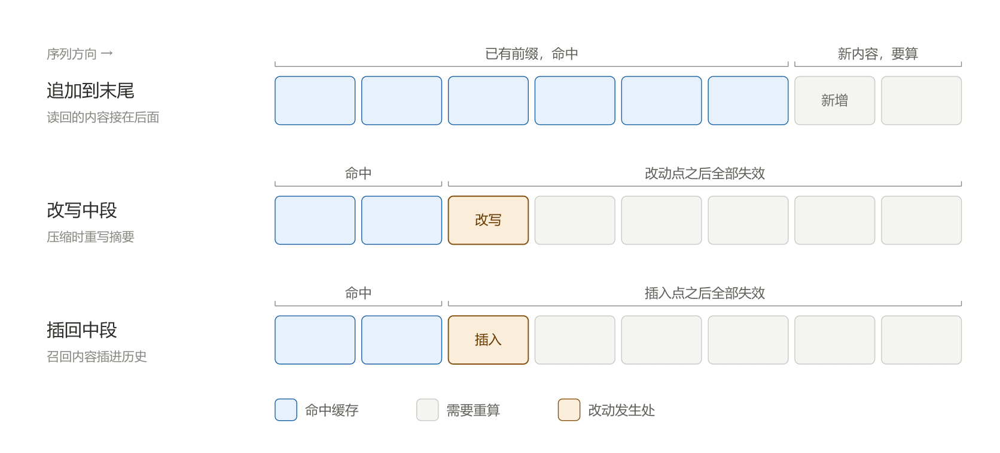
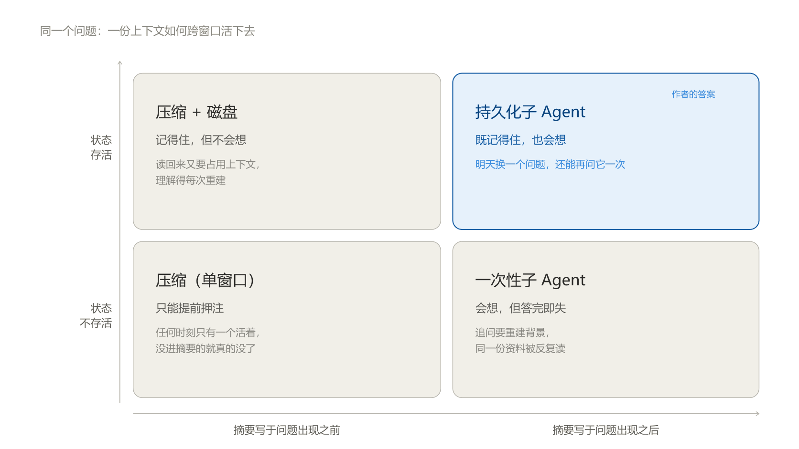
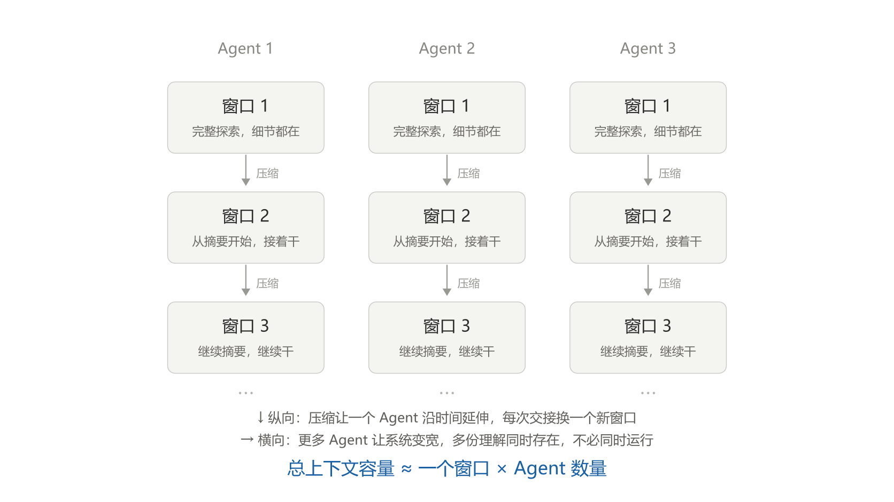
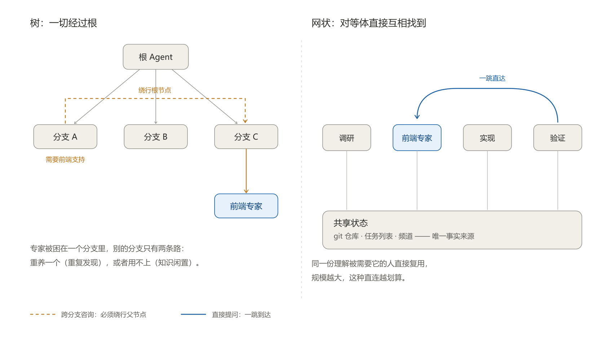
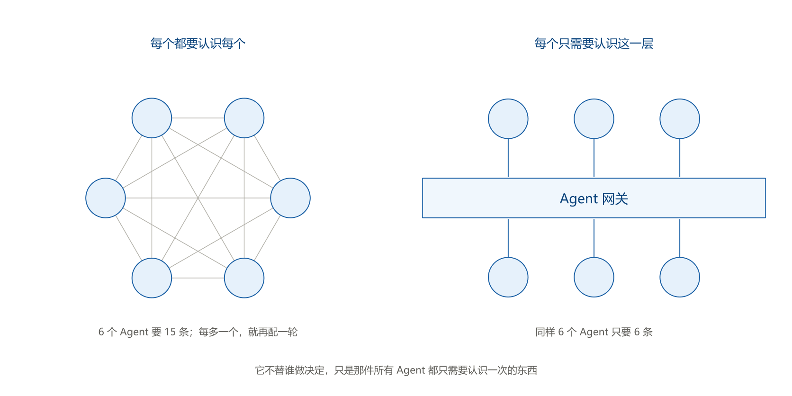

有一个矛盾，值得先摆出来。

前沿模型的上下文窗口这几年没有变大多少，基本停在 1M token 附近。你找不到任何一个严肃的模型宣称自己有 100M 的窗口。但今天的 Agent 经常在处理一些“明显装不进一个窗口”的任务——几万行代码的仓库、跑了几天的调试、跨十几个文件的重构。

如果只看窗口大小，这些任务不该被完成。它们被完成了，说明有一整套机制在悄悄把上下文搬来搬去。

Konstantin Dunas（hallerite）在[《On the Nature of the Swarm》](https://hallerite.com/posts/on-the-nature-of-the-swarm/)里把这件事推到了底：**推理扩展一旦开始作用于真实世界，就必然要“造出比一个窗口更多的上下文”，而造上下文的所有手段，最后都会走到多个 Agent 上。**

这不是一篇预测未来的文章。它做的是一件更朴素的事：把过去两年 Agent 工程里那些看起来互不相干的技术，放进同一条因果链里，让每一招都成为上一招的补丁。为了行文方便，下面提到他时我直接写作“作者”。

## 一、压缩的真相：它在赌未来

窗口总会满。最直接的办法是压缩：快满的时候让 Agent 写一份摘要，带着摘要进入一个全新的上下文，继续干活。循环往复，直到任务结束。

这招很有效。一个会话可以因此延续几天甚至几周。但它并不意味着你获得了无限上下文，它只是抬高了一个上限。作者把它称为 **total context capacity**，也就是系统能够承接的最大任务规模；这里，任务的规模用“一次做完需要多大的窗口”来度量。这是他为了讨论这个问题提出的一个概念。

压缩能把这个上限抬多高，取决于**有多少东西必须在每次交接时活下来**。

而这里有一条绕不过去的原则：**每一次压缩都是一次押注。**写摘要的那个 Agent 必须在信息还不完整的时候决定，什么在以后会重要。

作者举的例子很具体。某次跑测试，一行输出看起来很怪，但当时没有任何其他证据说明它和问题有关，于是它在摘要里被略过了。第三天，那行输出本可以成为定位 bug 的关键——但已经没人记得它存在过。

请注意这个例子的锋利之处：**换一个更聪明的总结者（LLM），也救不了你。**在第一天，丢掉那行是完全合理的判断。问题不在于总结能力不够，而在于判断依据本身还没出现。

真实任务大多是部分可观测的：某条信息是否重要，往往取决于你还没看到的东西。写摘要时知道当前目标，不等于知道后面会碰到的每一个问题。用一句被引用过很多次的话说：预测是很难的，尤其是关于未来的预测。

这是我读完后印象很深的地方。压缩会丢信息，我以前就知道；但“它在预测未来哪些信息会重要”这个说法，把困难讲得更具体了。即使在当时做出了合理的取舍，我们也可能在后续失去一条关键线索。

## 二、磁盘解决了“丢失”，但没有解决“理解”

既然摘要装不下细节，那就把细节放到外面。完整的日志、搜索结果、探索笔记都留在磁盘上，摘要里只保留一个指针。

这确实让赌注变小了。问题从“我需要记住什么”变成了“我需要知道什么东西存在”。作者在这篇随笔里引用了塞缪尔·约翰逊对知识的区分：我们自己知道的，以及我们知道去哪里能找到的。文件系统让我们不必把所有内容记在当前窗口里，只要在需要时能找回来。

但落地的时候，那三步比看上去难得多：下一个 Agent 得**先意识到**某份资料可能相关，**再找到**它，**最后读回**自己的上下文。

前两步常被“检索”两个字盖过去。实际上，如果 Agent 连那份资料存在过都不知道，它可能不会想到去查；即使发起了查询，索引粒度、文件组织、查询词也都会左右结果。资料存下来了，不等于它会在需要时被找到。

第三步更别扭：**读回来要占用上下文，而上下文正是我们一开始就快用完的那个东西。**

这三步在架构图上可能只有一根箭头，实际却要同时处理“该不该读”“去哪里读”和“读多少”。原文对最后一步的提醒，也让我更清楚地看到：把信息放到外面之后，使用它仍然需要成本。

### 读回太多，可能再次触发压缩

如果召回的文件很大，读完后又接近窗口上限，就可能触发新的压缩。压缩丢掉部分细节，后续发现信息不足，再读一次同一份文件。如果系统不记录“读过什么范围、基于哪个版本、得到了什么结论”，这个循环会反复收费。

所以，文件系统解决了存储容量的问题，却没有替我们决定哪些内容值得进入当前窗口。一份文件可以很大，当前问题真正需要的，也许只有其中几段。

### 回读占用窗口，缓存解决的是另一笔账

这里还会遇到 KV cache 的问题：文件读回来，会不会顺便让前面的缓存失效？

对于前缀缓存，把内容追加到历史末尾，已有的相同前缀仍有机会复用；如果改写历史、替换摘要，或者把内容插回中间，变化处之后的旧缓存则可能无法继续匹配。具体能否命中，还取决于缓存是否仍然有效等条件。[Claude 的缓存文档](https://platform.claude.com/docs/en/build-with-claude/prompt-caching)解释了这种前缀匹配机制。

三种情况画在一起，差别只有一件事：改动落在历史中的哪个位置。

命中区只到改动点为止。改动越靠前，作废的前缀越长——这也解释了为什么同样一次操作，替换历史摘要比追加内容贵得多。

因此，读文件并不天然意味着破坏缓存，压缩也不必然意味着全部内容都要重新处理。但即使命中缓存，读回的文本依然占据上下文窗口。**少做一次重复计算，与少占一段上下文，是两件事。**

所以缓存命中率不该单独当指标：它衡量省了多少重算，不衡量占了多少窗口。这两笔可以合成一笔——**完成这个任务，总共消耗了多少上下文**，把重算、占用、重复读都算进去。按这个口径，一段历史的去留不取决于它有没有被缓存，而取决于它还能不能改变下一个判断。这条判据会误伤一类场景：如果历史的价值在于事后追责或审计，那它该留在别处，不该指望留在窗口里。

### 先筛选，再让必要的内容进入上下文

缓解回读成本，一个直接的方向是渐进披露：先给目录、文件说明和命中位置，确定相关之后，再按范围读取正文。它让 Agent 逐步获得信息，而不必在第一次查询时就接收整份文件。

另一个方向，是让 Agent 写代码去处理材料。比如查找日志中的特定模式、统计错误分布、从表格里筛选相关记录，都可以先在执行环境里完成，再把必要的结果交回模型。Anthropic 在[《Code execution with MCP》](https://www.anthropic.com/research/code-execution-with-mcp)中讨论过这种做法：让中间数据在代码执行环境中流转和处理，减少穿过模型上下文的内容。

这条路线的本质，是把“读”从**上下文操作**变成**计算操作**：在窗口外 grep、聚合、统计，只把结论带回来。它该用在哪，判据只有一条——**这个问题需不需要看原文。**若只需要一个计数，返回统计结果就够了；若要解释某段代码为什么出错，实现和关键日志可能仍然得进屋。

### 资料还在，先前形成的理解呢

到这里，文件可以保存下来，也能通过检索、切片和代码处理减少回读。但还有一笔成本：前一个 Agent 读过这些资料之后，已经形成过一套认识。

它知道哪些实现彼此相关，哪些现象值得注意，哪些猜测已经被证据排除。我们当然可以把这些判断也写成笔记，但接手者仍要找到、读懂，并判断它们是否适用于眼前的问题。单有原始文件，不会自动恢复此前建立的理解。

这让我觉得，文件记忆的难点还包括：**已经支付过一次的探索和理解成本，下一次能复用多少？**

假设当前只想确认一次失败是否来自重试配置，主窗口可能只需要结论、依据和仍未解决的疑点。为了得到这些信息，我们是否必须把翻实现、比参数、查日志的全部过程，都放进这个窗口里？

有没有办法围绕这个已经明确的问题，先完成必要的探索，再让主窗口接收足以继续判断的结果？

## 三、子 Agent：摘要写在问题已知之后

在讨论子 Agent 之前，作者先给了一个让人眼前一亮的视角：**我们可以把连续压缩看作一个退化的多 Agent 系统。**前一个 Agent 探索、写下摘要，后一个 Agent 带着这份摘要接手。每一次压缩，都可以理解为一次交接。

界面上还是同一个助手，但从信息传递看，接手者能知道什么，完全取决于前面交给它什么。这个说法没有改动任何一行代码，却让“同一个 Agent”这个概念变得可以追问：任务能不能连续，取决于目标、证据和未解决的问题能不能连续，而不取决于会话是否还显示在同一个窗口里。

顺着这个视角看主 Agent 委派子 Agent，结论就自然掉出来了：

> 子 Agent 的汇报，也是一份摘要。但这一次，摘要是在问题已知之后才写的。

这是全文最锋利的一刀。

普通的上下文压缩，要为**尚未明确的后续问题**保留信息，所以只能猜；子 Agent 的汇报，可以围绕**已经给定的问题**筛选信息，所以不必猜。压缩是朝着未知目标压缩，委派是朝着已知目标压缩——后者的难度低得多。

从工程角度看，这才是委派除了“并行”和“职责划分”之外的第三个收益：**主 Agent 可以使用探索成果，而不必承载整个探索过程。**一个子 Agent 去查某个失败是否来自重试配置，它可以在自己的窗口里翻实现、比参数、看日志，烧掉 200k token；主 Agent 的上下文只增长“任务描述 + 结论”这几千 token。

子 Agent 返回的结果，可以包含结论、支持结论的代码或日志位置、排除过哪些解释，以及还有什么不能确定。主 Agent 拿到的是继续判断所需的依据，而不必重新经历整个探索过程。这里节省的是主窗口承载的过程，不意味着整个系统一定更省 token——Anthropic 实测多 Agent 系统烧掉的 token 是普通对话的十几倍，省的是**窗口**，不是账单。

于是那条判别标准也变得清晰了：子 Agent 特别适合**可分解、并且在交接与交付处有清晰边界**的工作。对这类任务，系统可以利用多个窗口完成探索，而主 Agent 不必持有那个混乱的中间过程。

我想把这条标准再压成一句可以当场使用的问句：

> **主 Agent 拿到结果后，能不能不重走一遍探索过程，就继续作出判断？**

这是一条事后验收标准，可以拿任务去测。“找出重试逻辑在哪”容易通过：拿到文件路径和行号，主 Agent 就能接着改。“确认这个测试为什么偶发失败”则难说——如果交回的结论没有附带证据和不确定性，主 Agent 仍然必须重读材料、重建全部背景，这次委派就没有隔离掉多少工作。

这里也要给“不需要预测”划个范围：子 Agent 知道当前问题，但不知道主 Agent 接下来会追问什么；主 Agent 写任务说明时，也可能漏掉全局约束。定向提取减少了一类不确定性，没有让交接自动无损。

那么，如果交回结果之后，我确实还有第二个问题呢？

## 四、把那个读过资料的 Agent 留下来

如果一次性子 Agent 已经结束，后续相关问题就得交给新的执行者，重新建立背景。对经常被追问的领域，这个成本会反复发生。

如果问题是回答结束后，刚建立起来的上下文也随之消失，那么一个自然的办法就是：**别把它销毁。留着它。**它保留着自己的上下文、文件和仍在运行的东西。下次遇到相关问题，直接问它——它已经读过相关材料，不需要从零开始，而你的窗口只增长“问题 + 回答”。

到这里，前面两半方案各自的缺陷有了对应的解法：像磁盘一样，工作状态可以保留下来；像子 Agent 一样，围绕明确的问题提炼结果；而且两者都没有的一点——**明天还能换一个问题再问一次。**

比如，它查过一套构建流程，知道哪些路径已经检查过、哪些配置会影响结果、哪些猜测被测试排除了。第二个问题不必重复第一个问题，也能沿着这些认识继续往下走。我们复用的，包含此前已经完成的探索。

第一次汇报也就不必承担所有未来用途：当前没问到的细节，之后还可以继续追问。

这张图是我对前四节的整理。两个维度分别是：状态能不能跨交接活下来，以及摘要是在问题出现之前还是之后写成。四种方案各占一角，只有右上角同时满足两个条件。

而一旦“多个 Agent 同时活着”成为可能，一个被严重低估的收益就浮现出来：**总上下文容量大致等于一个窗口乘以 Agent 数量。**

这里的前提是，各部分能够通过相对紧凑的信息交换协作。如果每个 Agent 都得重新装入其他人的全部背景，窗口数量增加并不能等比例扩大有效容量。

作者在这里的措辞值得记住：压缩让每个 Agent 沿**时间**方向延伸，更多的 Agent 让整个系统沿**横向**展开。即使这些 Agent 只能轮流运行——完全不并行——保留多份可以继续追问的上下文，依然有价值。因为**它们是在上下文上并行。**

这一点和“多 Agent 能同时干活所以更快”是两件事。后者是显而易见的，前者才是真正改变上限的。

两轴是乘法关系。一个 Agent 无论压缩多少次，都只是在同一条线上往下走；要变宽，就得真的多出几个 Agent。

保留状态也不是免费的，其中两笔常被忽略。

第一笔是管理成本：持久化 Agent 仍然会遇到压缩，旧认识也会过期，你得有办法核查它针对的是哪一版代码。保住“可以继续追问的机会”，不等于保住了正确的理解。

第二笔是苏醒成本。它的缓存之所以是热的，是因为它在运行；一旦空闲超过服务商的缓存有效期，回来第一个请求就是全量预热。**记忆是免费的，苏醒不是。**

所以“保留一个 Agent”的成本不随时间归零。保留多少个、保留多久，本身就是要算的账——横着铺开只是把成本从“每次重新理解”换成了“一直养着”，哪一种更便宜，取决于这个领域被追问的频率。

## 五、上下文建起来了，代价是通信

把前面四步放在一起看，会发现它们在做同一件事：**构建上下文。**

在理想世界里，正确的上下文一开始就都在窗口里，模型只需要输出答案。现实中模型得自己把它建起来——推理靠思考建，Agent 靠行动建（读文件、跑测试），而上面所有技巧，都是在建一个装不进单个窗口的上下文。

所以 Konstantin Dunas（hallerite）反对把多 Agent 称为“新的 scaling 轴”。他的判断是，**我们仍然在扩展推理算力，只是做得更有结构了。**

这个纠正不是修辞，它已经被实测数字顶住了。Anthropic 公布过一组自家系统的用量：Agent 的 token 消耗约为普通对话的 4 倍，多 Agent 系统约为 15 倍。这是他们自己的平均值，口径是“用量”而不是“收益”。同一篇里还有一个更值得记住的数字：在 BrowseComp 的分析中，仅 token 用量一项就解释了 80% 的性能差异，加上工具调用次数和模型选择，三个因素解释了 95%。

那个 80% 很刺。**它意味着多 Agent 换来的提升，主要来自它花掉了更多 token，而不是来自一种更聪明的组织方式。**容量确实被造出来了，但造容量的方式，就是造更多的上下文——这条因果链是闭合的，中间没有第三个变量。

（他们同时报告过一组更醒目的数字：多 Agent 比单 Agent 高 90.2%。但那组对照里主 Agent 是 Opus 4、子 Agent 是 Sonnet 4，比的是同样的预算怎么分配，不是纯结构的胜负。引用它的时候要小心。）

而更多的上下文，不是没有代价的。

**代价是通信。**一个 Agent 的发现要影响另一个 Agent 的判断，就得通过消息、文件或共享记录传过去。传摘要，接收者容易使用，但会舍弃细节；传完整材料，可以保留更多信息，却又把读取和理解的成本交给了接收者。各方各持一部分信息、为了共同算出结果至少需要交换多少内容，这类问题属于通信复杂度（communication complexity）的研究范围。**这个下界不随模型变强而下降——它量的是信息本身，不是谁更会表达。**

于是拆不拆，可以压成两项相减：**收益上限是被隔离掉的探索量，成本下限是交接面上必须传递的信息量。**一个子 Agent 在自己窗口里烧掉 200k、交回 3k 的结论，这一项是净赚；如果它只烧掉 30k，却要交回 25k 的说明才够用，拆分就只是把工作换了个地方做，还多付了一次上下文重建。我自己的经验界限大约是一比三：交接信息超过探索量的三分之一，拆分就很难回本。

由此得到一条清晰的边界：**如果任务里最难的部分，恰好需要所有信息同时在场，那么拆开并不能消除这个要求。**我们可能只是把“需要共同权衡这些背景”，变成了“需要在多个窗口之间反复同步”。

Anthropic 在这件事上说得很直接：需要所有 Agent 共享同一份上下文、或者彼此依赖很多的任务，今天不适合多 Agent。他们给的例子是团队按业务领域切出多个子 Agent，但这些子 Agent 持续使用同一批数据、依赖彼此的结果——独立窗口没有隔离掉多少探索，反而增加了交接。对这类任务，他们建议评估是否合回主循环，用 Skills 和工具搜索按需加载能力；依据是端到端表现，合并后哪些任务更好，哪些反而变差。

Cognition 在[《Don't Build Multi-Agents》](https://cognition.ai/blog/dont-build-multi-agents)里把这件事说得更重，而且给了两条可以直接拿去用的原则，大意是：

1. **共享上下文，而且共享完整的执行轨迹，不只是几条消息；**
2. **动作里携带隐含决策，而相互冲突的决策会带来糟糕的结果。**

他们的例子是“做一个 Flappy Bird 克隆”：拆成“背景和碰撞盒”与“会上下移动的小鸟”两条子任务，各自都做完了，合起来才发现背景长成了超级马里奥、小鸟也不是那个小鸟。**问题不在于谁偷懒，而在于两个执行者都在没人说明的地方做了自己的决定。**因此他们的结论是：默认排除不满足这两条原则的架构。

这两条原则看起来是冲着多 Agent 来的，其实和《On the Nature of the Swarm》说的是同一件事的两面。它们描述的都是**交接面信息熵高**的场合——决定没有说出口，所以传不过去。文章说的是另一头：当难点需要所有信息同时在场时，拆开只是把同步成本换了个地方付。**Cognition 给的是事前判据，文章给的是量级估算，两者不冲突，因为量的是同一个东西。**

作者还提出，一部分协调开销可能通过训练降低，让 Agent 更擅长与自己的副本协作。但**有些通信成本是结构性的**：必要的信息分散在不同窗口里，完成判断就仍然需要交换。这也给后面的 Harness 设计留下了一个问题：哪些辅助会随能力进步而退场，哪些约束需要系统持续承担？

## 六、树为什么会塌

沿着主 Agent 委派子 Agent、子 Agent 继续拆分的方式，很容易得到一棵任务树：根派生子 Agent，子 Agent 再派生，结果沿层级回流。

如果通信也只能沿父子关系进行，那么跨分支的问题就得逐级转述。当大量请求集中到少数共同上级，协调者本身就可能重新遭遇上下文瓶颈。它得理解各分支的问题、转达背景、汇总结果，窗口满了以后又要压缩——绕了一圈，问题被搬到了更高一层。

紧接着是第二个问题：**专业知识被困在分支里。**

设想某个 Agent 因为碰巧先看了前端，于是有了前端的上下文，可能还顺手造了个小工具。下一个前端问题交给它，比让任何其他 Agent 从零开始都便宜；它回答得越多，就越擅长。一个随机的早期差异，就这样固化成了一种角色分工。

如果每个子 Agent 都只服务于自己的父节点，前端专家长在 A 分支，而 C 分支遇到一个前端问题，就没法直接去问。请求必须上行到共同祖先，再下行——穿过一堆完全不关心前端的上下文。

作者指出，如果这份专业知识始终被限制在自己的分支里，其他分支就面临两个糟糕的选择：

- **每个分支重新建立自己的专家：**同样的材料被反复阅读，同样的认识被反复建立。
- **其他分支用不上这位专家：**理解已经存在，却没有被需要它的工作利用起来。

**持久化解决了“理解能不能留下来”，树状通信又把问题变成了“留下来的理解，谁能用得上”。**前面两半方案各自的缺陷，在组织结构里原样复活了一遍：一边是“会想但记不住”，一边是“记得住但用不上”。而且这是一道单选题——无论选哪边都是错的，这才是“两个选择都很糟”真正的力度。

下面这张图展示了一种把跨分支咨询集中到根节点的安排，以及允许直接咨询时的差别。图中的绕行路径，是这个组织方式对跨分支请求施加的限制。

**任务分工与通信路径，可以分别设计。**一个 Agent 可以由某个主 Agent 创建、管理和验收，同时直接咨询其他分支的专家。负责交付的关系依然清楚，知识的使用不必始终经过逐级转述。

顺带说明一件容易混淆的事：**“要不要隔离”和“要不要树”是两个独立问题。**树的问题是**被迫经过根**，不是**强制隔离**。你想要隔离，网状结构里让 Agent 只跟指定邻居说话同样可以；反过来，树也从不保证隔离——父节点的上下文里装着的，就是各分支的摘要。

更实用的判据是另一条：**依赖图是静态可预知，还是运行时才浮现。**

任务图是 DAG、分解在开工前就能定、分支间无横向复用、总量十个以内——树够用，而且它的隔离带来权限边界、可审计、成本可预测、失败可局部重试，这些都是真实收益。但如果“谁需要什么”是干起来才知道的（前端专家的出现就是教科书例子），静态树必然错：要么过度派生，要么漏掉。

作者给的粗略判断是：十个 Agent 的时候树大概还行，一万个的时候，就必须是对等体自己互相找到、自行分工了。

我更愿意把它读成趋势而不是阈值。数量决定的是**协调成本的增长速度**，而结构成不成立，取决于依赖关系是静态还是运行时浮现。十个节点也可能必须对等（依赖天天在变），一万个也可能不必（切分固定、依赖清晰）。数量是压力，依赖形态才是判据。

作者在这里引了两位经济学家。哈耶克指出，中央计划必然失败，因为运行经济所需的知识分散在千万人手里，送不到中心。根 Agent 就是那个中央计划者：要协调得好，它需要全部上下文；而全部上下文，恰恰是装不进一个窗口的东西。

但允许直接交流之后，寻找合适的人、解释需求、协调冲突，也有成本。层级究竟应该保留在哪里？

这就接上了这篇随笔引用的另一个视角。科斯在《企业的本质》中追问：如果市场这么擅长协调，为什么还需要企业？使用市场也有成本，每次都要找到对的人、解释需求、达成约定；当组织内部的协调更便宜时，层级就有了价值。放到 Agent 系统里，这提供了一个判断方向：哪里集中协调能降低成本，哪里就有保留层级的理由。

## 七、蜂群该长成什么样

Konstantin Dunas（hallerite）很坦率：他也不知道正确结构是什么，而且纯网状大概也不对。

我把这篇随笔末尾的讨论，整理成三个方向。

**第一，先模仿人类组织。**给 Agent 我们用的那些工具——共享的 git 仓库、issue tracker、聊天频道——让它们在共享状态上工作，并把共享状态作为唯一事实来源。

**第二，结构与规模匹配。**五个人的创业公司几个频道就够，一万人不行。这也呼应了布鲁克斯对协调开销的提醒：如果所有人都要彼此联系，潜在的成对沟通关系会随人数近似按平方增长。组织规模变大之后，需要重新安排谁与谁交流。

**第三，也是最关键的：不要把结构写死。**可以先按人类组织播种，再让 Agent 在解决问题的过程中自己改造它——这样就把“苦涩的教训”重新请回来了：随算力扩展的通用方法，最终会战胜基于人类知识的设计。

关于共享状态，我想补一句它最容易出事的地方：**共享不等于可信。**一条记录必须能让人分辨——这是已验证的事实，还是待检查的猜测？它针对哪个版本？被什么后续结果更新过？没有这层元信息，一个 Agent 的误判也可能顺着共享记录被其他 Agent 当成事实继续使用。

所以，我更愿意期待这样的配合：**共享记录负责“可发现、可核验、可恢复”，持久化 Agent 负责“深入追问和继续探索”。**前者让知识横向流动，后者让理解可以沉淀。层级不必消失，但应该退到只做两件事：仲裁冲突、控制预算。

代价也是明确的。现在讨论多 Agent 协调，绕不开一个三难：**低延迟、容错、去中心化，三者只能取其二。**层级用去中心化换速度和可预期的成本；对等网络用延迟换韧性；事件驱动用一致性换规模，代价是竞态——两个 Agent 抢同一个任务，或者基于过期状态做了决定。没有免费的组合，只有与场景匹配的取舍。

我自己的取舍是牺牲去中心化：对内部工具这类系统，能不能查、成本会不会失控，比中心节点是不是单点更重要。但这是偏好，不是定论——如果目标是跨组织协作，中心节点就成了别人可以卡住你的地方，那时候反过来的取舍才成立。

这还留下许多具体问题：谁发现共享记录已经过期？多个 Agent 同时修改任务状态时怎么办？大家都向同一位专家提问，它会不会成为新的瓶颈？这些问题，会继续影响蜂群的组织方式。

## 八、哪些开销该交给模型，哪些必须留在 Harness

作者那句“有些通信成本是结构性的”，看起来像一句脚注，其实是工程判断的分水岭。

做 Agent 时，我会据此分清两类工作。第一类在辅助模型作判断：怎么把任务拆得合适、摘要该保留什么、什么时候该追问、什么时候该同步。这些能力有机会随着模型和训练改进而提高。第二类在落实系统约束：状态能否持久、动作能否回滚、谁有权执行、并发修改怎么处理、失败怎么恢复。

**第一类不要写死在 Harness 里。**为当前能力短板增加的辅助，应当保持可替换，用真实任务反复验证“新模型是否还需要这层辅助”。如果它已经不能改善结果，却仍然强迫模型绕行，就成了维护负担。

**第二类必须做，而且要做硬。**模型进步能改变“谁来作判断”，但不会替系统决定“哪些操作有权执行”。

对于前面讨论过的通信与组织，我会这样区分模型进步和系统设计的职责：

| 层次 | 模型进步可能改善什么 | 系统仍需明确什么 |
|---|---|---|
| 信息交换 | 更好的提问、摘要与追问，减少无效往返 | 当前任务必须交换哪些信息 |
| 协议交互 | 更准确地使用接口和处理交互异常 | 身份、消息格式、权限与任务状态约定 |
| 组织协调 | 更合适的委派、专家发现与协作选择 | 谁能联系谁，预算如何控制，失败由谁接手 |

A2A 处理的是不同 Agent 系统之间的互操作：发现能力、交换消息、管理协作任务，[A2A 规范](https://a2a-protocol.org/latest/specification/)对这些交互作了公共约定。它的价值在于把 N×M 的适配成本摊成 N+M；只要异构系统存在，这件事就一直成立。所以它该做，但不该做厚：协议层最终会退化成一层很薄的传输语义，像 HTTP 之于浏览器——没人再关心报文格式，但没人能不用它。真正重的是语义层的协商，而那一层会被模型吃掉。

结构性通信成本说的是另一件事：为了共同完成判断，必要信息必须被交换。这推不出“必须采用某种协议”，只推得出“这套协议要做到多薄”。把这两件事混在一起，会得出一个错误的结论——以为装上一个协议，通信成本的问题就解决了。

协议能薄，是因为有人替它做厚。第七节末尾留下的那三个问题——谁发现记录已经过期、谁裁决并发写、谁决定热点专家要不要扩容——都不是模型能自己解决的，它们需要一个共同的位置来处理。各自实现一遍，就是前面说的重复发现；没人实现，就是谁都不负责。

单个 Agent 系统里，这个位置叫 Harness。一旦 Agent 分属不同进程、不同团队甚至不同厂商，Harness 就管不到对方了，那些约束只能落在通信路径上——一个所有调用都要经过的中间节点。这个位置现在被叫作 **Agent 网关**。

共享状态能把一个群体内部的协作摊平——git 仓库、issue tracker 是唯一事实来源，所以谁也不必认识谁。但它跨不过组织边界。一旦 Agent 分属不同进程、不同团队甚至不同厂商，共享状态就不在了，剩下的只有连接本身。

而连接要付的代价是平方级的：n 个 Agent 两两认识，需要 n(n-1)/2 条；每个只认识这一层，就只要 n 条。

六个 Agent，左边 15 条，右边 6 条。再加一个，左边要补 6 条，右边只要补 1 条。

名字里有“网关”，最容易的误解是把它当成 API 网关再加上几项和 Agent 有关的功能。真正的差别不在功能清单，而在失败模型。API 的一次调用失败，重试一次的代价是多一次请求；Agent 的一次任务失败，重试的代价是重跑那段探索。重跑不是重新发一个包，是从头把上下文再建一遍——前面算过的压缩、回读、子 Agent 交付，全部要重来。

所以这个位置要管的不是转发快不快，而是失败之后能不能接上：任务走到哪一步、哪些中间结果已经确定、哪些已经被验证过，得有人替它记住，而不是等下一个 Agent 重新发现一遍。这和模型强不强没关系——再强的模型也不会知道它上次跑到哪儿了。

这并不等于它不用转发、不用鉴权、不用限流。这些动作一个都没少，变的是它们各自回答的问题。API 网关鉴权，回答的是“这个调用者能不能访问这个接口”；Agent 之间鉴权，回答的是“它现在以什么身份、在多少预算内、还能把这些委派给谁”。前者一次调用就结束，后者要跨过几十次状态变更、中断和追问。同一个动作，因为要活得更久，就从“校验一次”变成了“持续担保”。

这一层做的所有事，其实是同一个动作：不让已经做过的事再做一遍。不让每个 Agent 各自记一遍地址，不让一次鉴权在几十次调用里重复做，不让一次中断把整段探索作废。也正因为重复的那部分由它做过一次，它自己才不需要懂内容。

## 结语：从“能做什么”转向“怎么被用起来”

回到开头那个矛盾。1M 的窗口能完成远超 1M 的任务，不是因为模型偷偷变大了，而是因为上下文被**构建**出来了——先靠压缩串起时间，再靠持久 Agent 铺开横向，最后靠组织结构决定这些理解之间怎么流动。

如果这条推导成立，它会改变我们审视一个 Agent 系统的方式。除了“用了什么框架”，我会多问三个问题：

哪些背景值得被多个 Agent 共同持有？哪些探索适合独立完成，只交付结论？已经读过、验证过的东西，下一次还能怎样被用起来？

这三个问题没有把我带到一个确定的蜂群架构。但它们把关注点从“更多 Agent 能做什么”，换成了“已经形成的理解，怎样在整个系统里被有效使用”。

所以我判断一个 Agent 系统好不好，已经不太看它有几个 Agent，而看四件很具体的事：**上下文被放在哪里，谁能取到，什么时候会过期，以及已经形成的理解能不能被再次利用。**

---

**参考**

- Konstantin Dunas（hallerite）, [On the Nature of the Swarm](https://hallerite.com/posts/on-the-nature-of-the-swarm/), 2026
- Anthropic, [How we built our multi-agent research system](https://www.anthropic.com/engineering/multi-agent-research-system), 2025
- Cognition, [Don't Build Multi-Agents](https://cognition.ai/blog/dont-build-multi-agents), 2025
- Anthropic, [Building agents: when to fold subagents into your main agent loop](https://claude.com/resources/articles/building-agents-when-to-fold-subagents-into-your-main-agent-loop)
- Anthropic, [Code execution with MCP](https://www.anthropic.com/research/code-execution-with-mcp)
- Anthropic, [Prompt caching](https://platform.claude.com/docs/en/build-with-claude/prompt-caching) / [Context editing](https://platform.claude.com/docs/en/build-with-claude/context-editing)
- [Agent2Agent Protocol](https://a2a-protocol.org/latest/specification/)
- R. Coase, *The Nature of the Firm*, 1937；F. Hayek, *The Use of Knowledge in Society*, 1945
